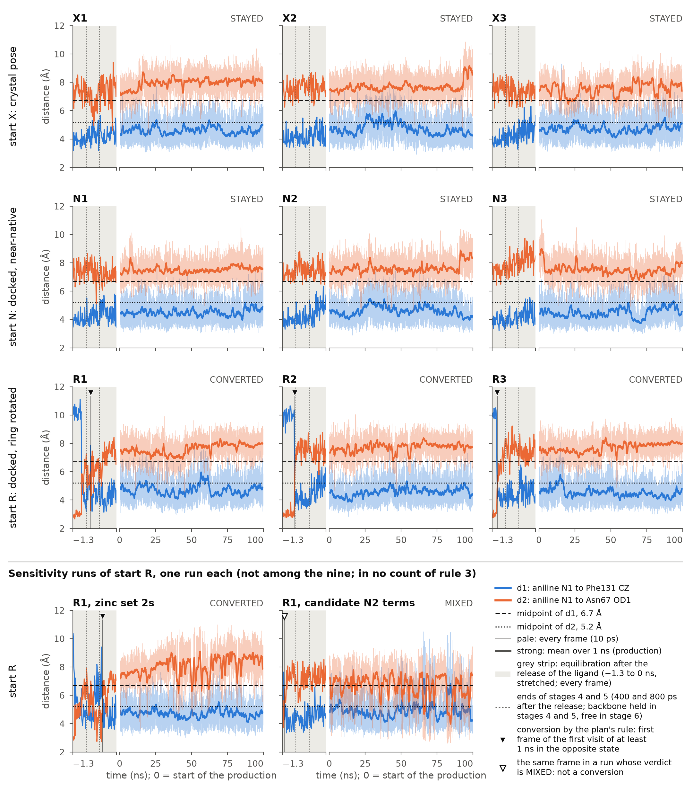

# Molecular dynamics of hCA II with the sulfanilamide anion on the zinc (PDB 6RL9): results of the campaign

Stage S6 of `md/PLAN.md`. Assembled on 11 Oct 2026, 11:50 AM IST by `md/production/assemble/make_results_md.py` from the records named beside each number. No result is typed: every count, mean, time and verdict is read from a file. Constants of the protocol and of the definitions are typed in the script (the 10 ps between solute frames, the 2.6 Å about the zinc, the 90 % of the verdict and the like), and the script stops if a statement it makes does not hold in the records. The sentences of the plan and of the other records are cut out of those files by the script. Times are IST (UTC+5:30). This file is a record for the authors: no text of the paper was written or changed (plan, section 7: "No text is changed before the user has seen the results").

The campaign: nine production runs of 100 ns with zinc set 2e (three from the crystal pose, start X; three from the docked near-native pose, start N; three from the docked ring-rotated pose, start R), two sensitivity runs of start R, and the two validation runs X0 of 5 ns. The last run ended on 8 Oct 2026, 3:45:58 AM IST; the guard's final check of 8 Oct 2026, 4:12 AM IST reports `verified` true (section 8).

**State of this record.** The two analysis programs agree on every run and on the campaign rules (gate of stage S6, exit status 0; section 9). The first assembly of this file (8 Oct 2026, 5:20 AM IST) was read by two audits, one of the numbers and one of the rules and the wording, and the trajectories were read by an independent physical review and by a blind third reading (`results/independent/`). Both audits found that the numbers, the verdicts and the application of rules 1 and 3 stand, and both asked for corrections: last digits in section 8, and sentences that said more than the data show or that put a limit more softly than the data give it. No finding of the review invalidates a run. Each point was checked again from the files before it was entered. The corrections are listed in section 11, and this file replaces the first assembly. Three limits that the first assembly put too softly are stated here before anything else:

1. In R1, R2 and R3 the configuration at N2 changed 140 to 360 ps after the release of the ligand, and the first frame outside the rotated-like state came at 150 to 360 ps: in all three runs in equilibration stage 4, while the protein backbone was held with 250 kJ mol⁻¹ nm⁻² to the coordinates of the crystal structure. No run of the nine holds the rotated configuration at N2 with that restraint lowered or removed, and the 90,000 production frames of the nine runs hold 0 rotated-like frames (section 7, point 4).
2. Of the known errors of the force-field terms at N2, one has the sign of the outcome: the force field puts the R-like placement +3.38 kcal mol⁻¹ too high against the crystal-like one, and a placement drawn too high is left more readily and returned to less readily. How much of this acts in the protein is not known, its sign rests on the dispersion term of the reference, and most of it comes from charges fitted to the crystal pose alone, which all eleven long runs share (section 7, point 3).
3. That no run returned to the rotated-like state is what the terms as built give, and they hold the nitrogen too stiffly by the numbers of gate G-R. With the candidate terms, which err the other way, the one run from start R is MIXED by the same rule (section 7, points 3 and 12).

## 1. Outcome in short

| | Result | Read from |
|---|---|---|
| Gate of stage S6 (the two programs agree) | **Exit status 0.** The two programs agree on all 15 folders with a trajectory below `/root/cqc-sfa-md/runs` (the 13 runs of this file and the two pre-flight test folders) and on the campaign rules: 6,721,008 values of the runs and 65 of the campaign compared, 0 disagreements beyond tolerance, 0 threshold items, 0 keys in one program only (section 9) | `results/gate/gate_S6.exit_status`, `results/gate/gate_S6.log`, `results/campaign/second_program/recheck_report.json` |
| Rule 1 (validation by the crystal starts) | Plan: "If the crystal-start runs leave the crystal orientation (ligand RMSD above 2 Å for the last half of the run) in two or three of three runs, the force field contradicts the 1.0 Å structure. The simulation is then not used as support for anything and is reported as a failed validation." Read as fixed on 5 Oct 2026, 8:40 PM IST: "ligand RMSD above 2 Å for the last half of the run" is read as the mean RMSD over the last half of the run. **Found: 0 of 3 crystal-start runs left the crystal orientation** (mean ligand RMSD of the last half: X1 0.58, X2 0.53, X3 0.56 Å; limit 2.0 Å). Rule 1 is not failed (section 3) | `results/campaign/first_program/campaign.json` (`rules_per_model.bonded_2e.rule1`), the `summary.json` of X1 to X3 (`validation`) |
| Rule 3 (the nine runs) | Plan, first case of rule 3: "Rotated starts convert in two or three of three runs, crystal and near-native starts stay: the rotated orientation is not stable outside the scoring function." **Found: R1, R2 and R3 CONVERTED; X1, X2, X3, N1, N2 and N3 STAYED** (verdicts over the last 20 ns). By the rule as worded this is its first case (`rotated_converts` in `campaign.json` of both programs, final: nine complete runs). All three conversions lie before time zero, in the equilibration after the release of the ligand; in the plan's wording (entry of 6 Oct 2026, 11:40 AM IST, point 2): R1 "converted during the equilibration, 540 ps after release", R2 "converted during the equilibration, 370 ps after release", R3 "converted during the equilibration, 160 ps after release". These are the times of the plan's rule, the start of the first crystal-like visit of at least 1 ns. The sign at N2 turned positive at 260, 360 and 140 ps and the first frame that is not rotated-like came at 270, 360 and 150 ps: in stage 4 in all three runs, with the protein backbone held at 250 kJ mol⁻¹ nm⁻² (section 7, point 4). The same entry: "A rotated run whose production holds no rotated frame is reported as "converted during the equilibration, t ps after release", with the series of the equilibration shown; it counts as converted in rule 3." The production of R1, R2 and R3 holds 0 rotated-like frames of 30,000 | `results/campaign/first_program/campaign.json`, `results/campaign/second_program/campaign.json`, `results/conversion_times.json` |
| Sensitivity run with zinc set 2s (`bonded_2s/R1`; in no count of rule 3) | **CONVERTED**; "converted during the equilibration, 890 ps after release" (the time of the plan's rule, in stage 6; the sign at N2 turned positive at 30 ps and the first frame that is not rotated-like came at 60 ps, in stage 4); 1 rotated-like frame of 10,000 in the production. Set 2s failed gate G-V in its validation run by one all-atom frame (section 6) | `results/runs/bonded_2s/R1/first_program_summary.json`, `results/conversion_times.json` |
| Sensitivity run with the candidate terms at N2 (`bonded_2e_n2fit/R1`; in no count of rule 3) | **MIXED**: in the last 20 ns 74.35 % of the frames are crystal-like, 9.15 % rotated-like and 16.50 % intermediate. The first crystal-like frame came 20 ps after the release and the first visit of at least 1 ns in the crystal-like state began at 60 ps; with the verdict MIXED this is no conversion. In the production the ring went back to the rotated-like state 124 times, never for 1 ns (longest visit 0.75 ns). A rotated-like frame is read from d1 and d2 only: of the 393 rotated-like frames of the production 179 have the sign at N2 of the crystal pose, and the ligand is within 1.0 Å of the docked rotated pose in 80 frames, so these counts are not counts of returns to the docked pose. These terms were not accepted by gate G-R2 and are used only to bracket (section 6) | `results/runs/bonded_2e_n2fit/R1/first_program_summary.json`, `results/run_events.json` |
| What the outcome rests on | The force-field terms at the sulfonamide nitrogen N2 (plan, 6 Oct 2026, 3:02 AM IST, point 1: "these terms and the H–N2–S–C4 series decide whether a run converts") failed two quantum-chemical gates (G-R and G-R2) and are used as built by the user's decision of 6 Oct 2026, 9:15 PM IST. By the plan's rule the three conversions of the nine runs lie 160 to 540 ps after the release of the ligand, before the production began; the change of sign at N2 lies at 140 to 360 ps, in stage 4, with the protein backbone held. (The sensitivity run with set 2s, in no count: 890 ps by the rule, change of sign at 30 ps.) Of the known errors of these terms the R-like placement drawn +3.38 kcal mol⁻¹ too high has the sign of the outcome, and with the candidate terms the one run from start R is MIXED. Section 7 lists these and the other limits with the direction of each error as the records give it. The plan allows "no statement on rates or on the height of a barrier" | `md/PLAN.md`, `md/GR.md`, `md/N2.md`, `results/run_events.json` |

The campaign table of the first program also prints an outcome line for the two sets with one run each (`bonded_2s`, `bonded_2e_n2fit`). By the plan (entry of 7 Oct 2026, 12:10 AM IST, point 9) "these lines are not outcomes of rule 3 and are not quoted"; they are not given here. Of the sensitivity runs the plan says (entry of 6 Oct 2026, 9:15 PM IST, point 3): "They are reported as sensitivity runs and enter no count of rule 3."



*Figure 1.* The two distances of the orientation coordinate (rule 2 of the plan) against time: d1, aniline N1 to Phe131 CZ, and d2, aniline N1 to Asn67 OD1, with their midpoints 6.7 and 5.2 Å. Grey strip: the 1.3 ns of the equilibration after the release of the ligand (stages 4 to 6), time axis stretched. In the production the pale line is every frame (10 ps) and the strong line the mean over 100 frames. A filled triangle marks the conversion by the plan's rule. In the panel of the candidate terms the triangle is open: the verdict of that run is MIXED, and the triangle marks the start of its first crystal-like visit of at least 1 ns, not a conversion. The two thin broken lines in the grey strip are the ends of stages 4 and 5, 400 and 800 ps after the release: the protein backbone is held in stage 4 (250 kJ mol⁻¹ nm⁻²) and in stage 5 (50) and free in stage 6. File `results/fig_orientation.png` (and `.pdf`), drawn by `md/production/make_result_figures.py`; sources and checks in `results/fig_sources.json`. The ligand RMSD in the same layout: `results/fig_ligand_rmsd.png`.

## 2. The eleven runs

| Run | Start | Zinc set; terms at N2 | Length (ns); frames, solute / all-atom | Verdict (last 20 ns) | Last 20 ns: crystal-like / rotated-like / intermediate (%) | Whole run: crystal-like / rotated-like / intermediate (%) | First passage in the production (ns) | Conversion, time from the release (plan's rule) | Transitions | Mean d1; d2 of the last half (Å) |
|---|---|---|---|---|---|---|---|---|---|---|
| X1 | X | 2e; as built | 100.00; 10,000 / 1,000 | STAYED | 99.75 / 0.00 / 0.25 | 99.53 / 0.00 / 0.47 | none | none | 0 | 4.62; 8.08 |
| X2 | X | 2e; as built | 100.00; 10,000 / 1,000 | STAYED | 99.65 / 0.00 / 0.35 | 98.64 / 0.00 / 1.36 | none | none | 0 | 4.55; 7.77 |
| X3 | X | 2e; as built | 100.00; 10,000 / 1,000 | STAYED | 98.75 / 0.00 / 1.25 | 99.50 / 0.00 / 0.50 | none | none | 0 | 4.69; 7.63 |
| N1 | N | 2e; as built | 100.00; 10,000 / 1,000 | STAYED | 99.55 / 0.00 / 0.45 | 99.80 / 0.00 / 0.20 | none | none | 0 | 4.54; 7.56 |
| N2 | N | 2e; as built | 100.00; 10,000 / 1,000 | STAYED | 99.90 / 0.00 / 0.10 | 99.44 / 0.00 / 0.56 | none | none | 0 | 4.56; 7.69 |
| N3 | N | 2e; as built | 100.00; 10,000 / 1,000 | STAYED | 99.40 / 0.00 / 0.60 | 99.71 / 0.00 / 0.29 | none | none | 0 | 4.60; 7.39 |
| R1 | R | 2e; as built | 100.00; 10,000 / 1,000 | CONVERTED | 99.65 / 0.00 / 0.35 | 99.13 / 0.00 / 0.87 | 0.01 | 540 ps, in the equilibration (stage 5) | 1 | 4.77; 7.88 |
| R2 | R | 2e; as built | 100.00; 10,000 / 1,000 | CONVERTED | 99.65 / 0.00 / 0.35 | 99.63 / 0.00 / 0.37 | 0.01 | 370 ps, in the equilibration (stage 4) | 1 | 4.68; 7.83 |
| R3 | R | 2e; as built | 100.00; 10,000 / 1,000 | CONVERTED | 100.00 / 0.00 / 0.00 | 99.51 / 0.00 / 0.49 | 0.01 | 160 ps, in the equilibration (stage 4) | 1 | 4.39; 7.88 |
| *sensitivity runs, in no count of rule 3* | | | | | | | | | | |
| 2s/R1 | R | 2s; as built | 100.00; 10,000 / 1,000 | CONVERTED | 99.45 / 0.00 / 0.55 | 98.76 / 0.01 / 1.23 | 0.01 | 890 ps, in the equilibration (stage 6) | 1 | 4.71; 8.22 |
| 2e_n2fit/R1 | R | 2e; candidate not accepted by G-R2 | 100.00; 10,000 / 1,000 | MIXED | 74.35 / 9.15 / 16.50 | 87.22 / 3.93 / 8.85 | 0.01 | 60 ps (stage 4): start of the first crystal-like visit of at least 1 ns; no conversion, the verdict is MIXED | 1 | 5.11; 6.45 |

Starts as built (`md/system/starts.csv`; here from the build record in each manifest, `results/run_health.json`): X d1 3.90, d2 7.74 Å; N 3.36, 7.73 Å; R 9.58, 2.60 Å. A frame is crystal-like if d1 < 6.7 Å and d2 > 5.2 Å, rotated-like if d1 > 6.7 Å and d2 < 5.2 Å, intermediate otherwise (`md/analysis/SPEC.md`, section 4). Verdict, in the plan's words (5 Oct 2026, 8:40 PM IST): "A run has converted if at least 90 % of the frames of its last 20 ns are in the state opposite to its start, has stayed if at least 90 % are in the state of its start, and is mixed otherwise."

How to read three columns, and what the time of the rule is not:

- **First passage in the production** is counted by the two programs from the start of the production only. The value 0.01 ns of the five runs from start R is the time of the first production frame: the run was already in a visit of at least 1 ns in the crystal-like state when the production began.
- **Conversion, time from the release** is the number the plan asks for (entry of 7 Oct 2026, 12:10 AM IST, point 1): "The time of the conversion is the time of the first frame of the first long visit in the opposite state, counted from the start of stage 4." It is formed on the frames of equilibration stages 4, 5 and 6 joined with the production, from the `state` written by both programs; the two give the same frame in all 13 runs (`md/production/conversion_time.py`, tested by `md/production/test_conversion_time.py`; `results/conversion_times.json`). The plan: the time describes one run; "it is not a rate".
- For `2e_n2fit/R1` the rule gives a time although the verdict of the run is MIXED: 60 ps is when its first visit of at least 1 ns in the crystal-like state began, not the time of a conversion. The rule was applied as worded. Its one transition counts visits of at least 1 ns only; the shorter visits to the rotated-like state are in section 6.
- **The time of the rule is not the time at which the ligand left the rotated-like state.** First frame with the sign at N2 positive and first frame that is not rotated-like, from the release: R1 260 and 270 ps; R2 360 and 360 ps; R3 140 and 150 ps; 2s/R1 30 and 60 ps; 2e_n2fit/R1 20 and 20 ps. In every one of the five runs both lie in stage 4 (0 to 400 ps after the release; protein backbone held at 250 kJ mol⁻¹ nm⁻²). The time of the rule is later where the ring went back for single frames: R1 540 ps (stage 5), 2s/R1 890 ps (stage 6). Sections 4 and 6 give the frames.

The sign at N2, used here and below, is the sign of the signed volume of Zn, H and S about N2 (specification, section 9A): positive in the crystal pose and in start N, negative in start R (`n2_configuration.sign_of_start` of each `summary.json`). Its limit, in the words of the specification (section 15): "The sign at N2 (section 9A) says on which side of the plane of its neighbours the nitrogen is in a frame. It is not a barrier and not a population, and with the hydrogen placed by the force field it is only as good as the angle terms at N2 (plan, gate G-R). No rule uses it."

## 3. Validation by the crystal starts (rule 1)

| Run | Ligand RMSD to the crystal pose, mean ± SD (Å) | Mean of the last half (Å) | Largest (Å) | Hydrogen bond N2–H···OG1(Thr199), % of frames | C4–S–N2, mean ± SD (°); mean minus 6RL9 | τ_fold, mean ± SD (°); mean minus 6RL9 | Last half above 2.0 Å (rule 1) |
|---|---|---|---|---|---|---|---|
| 6RL9 (start X as built) | 0.00 | | | N2–H···OG1 163.7°, N2···OG1 2.86 Å | 108.8 | 132.1 | |
| X1 | 0.56 ± 0.23 | 0.58 | 1.80 | 99.86 | 109.5 ± 2.7; +0.7 | 132.4 ± 13.6; +0.3 | no |
| X2 | 0.54 ± 0.22 | 0.53 | 2.28 | 99.86 | 109.4 ± 2.7; +0.6 | 130.9 ± 12.9; -1.2 | no |
| X3 | 0.54 ± 0.21 | 0.56 | 1.75 | 99.83 | 109.3 ± 2.6; +0.5 | 130.3 ± 11.8; -1.8 | no |
| N1 | 0.53 ± 0.22 | 0.53 | 1.78 | 99.82 | 109.3 ± 2.6; +0.5 | 131.5 ± 13.0; -0.6 | no (not counted by rule 1) |
| N2 | 0.54 ± 0.24 | 0.53 | 1.88 | 99.85 | 109.5 ± 2.7; +0.7 | 132.9 ± 14.4; +0.8 | no (not counted by rule 1) |
| N3 | 0.61 ± 0.27 | 0.67 | 1.95 | 99.77 | 109.4 ± 2.7; +0.6 | 135.0 ± 17.3; +2.9 | no (not counted by rule 1) |
| 2e/X0 (validation run, 5 ns; gate G-V PASSED) | 0.55 ± 0.22 | 0.57 | 1.39 | 99.80 | 109.6 ± 2.5; +0.8 | 131.4 ± 13.6; -0.7 | no (not counted by rule 1) |

**Rule 1 as worded:** "If the crystal-start runs leave the crystal orientation (ligand RMSD above 2 Å for the last half of the run) in two or three of three runs, the force field contradicts the 1.0 Å structure. The simulation is then not used as support for anything and is reported as a failed validation." **Verdict:** the mean ligand RMSD of the last half is X1 0.58, X2 0.53, X3 0.56 Å in the three crystal-start runs, against the limit of 2.0 Å; 0 of 3 left the crystal orientation, so rule 1 is not failed. The three near-native starts are shown beside; rule 1 does not count them.

In the six runs the largest RMSD of a single frame is 2.28 Å (X2), the hydrogen bond to Thr199 is present in 99.77 to 99.86 % of the frames, no frame is rotated-like (0 of 60,000), the sign at N2 is that of the start in every frame, and the smallest RMSD is always found with the atom labels as they are (labelling `identity` in all frames). The mean C4–S–N2 angle lies +0.5 to +0.7° from the crystal value and the mean τ_fold -1.8 to +2.9°. The numbers of gate G-V are written for every run, without a verdict: for a production run they are not a second validation (`md/analysis/SPEC.md`, sections 11 and 15), and the gate was decided on run X0 alone (`md/PRODUCTION.md`, section 5).

**What "stayed" shows and what it does not.** In the six runs the signed volume at N2 lies between +0.16 and +0.92 from the release of the ligand to the end, and its size is below 0.2 in 0 to 1 of 10,000 production frames per run: the nitrogen stays pyramidal throughout. By the numbers of gate G-R the terms as built overstate the cost of flattening it (the hydrogen moved into the plane 5.20 against 0.46 kcal mol⁻¹ in quantum chemistry, the planar nitrogen on the constructed path 13.76 against 6.62; section 7, point 1). So "0 of 60,000" is what these terms give in these six runs. It is not evidence about the molecule, and rule 1 tests whether the crystal pose is kept, not whether it is kept too firmly (section 7, point 12). It is also a statement about these six runs only. In the rehearsal of 6 Oct 2026, which was a test of the pipeline, is no result and enters no count, the run of 5 ns from start N (TN0; the same topology, start coordinates, protocol and driver as N1: `system.prmtop` sha256 `98e46802e34a…` in both manifests) had 3 rotated-like frames of 500, at 1.38 to 1.40 ns (d1 8.16, 8.01, 9.74 Å; d2 4.00, 3.11, 2.74 Å; signed volume at N2 -0.43, +0.23, -0.34, so negative in 2 of them), and was crystal-like again in the next frame (`md/test/rehearsal_2e/runs/TN0/analysis/timeseries_solute.csv`; `md/test/REHEARSAL_2e.md`).

N3 has the largest mean of the last half (0.67 Å): between 60 and 80 ns its mean RMSD is 0.82 Å, against 0.54 to 0.58 Å in its other four blocks of 20 ns (`results/run_events.json`; figure `results/fig_ligand_rmsd.png`).

## 4. The rotated starts, run by run

The ligand is held in stages 1 to 3 of the equilibration (heavy atoms of the solute, 250 kJ mol⁻¹ nm⁻² in stage 3) and is released at the start of stage 4. After the release: stage 4, 400 ps with the protein backbone held at 250 kJ mol⁻¹ nm⁻²; stage 5, 400 ps at 50 kJ mol⁻¹ nm⁻²; stage 6, 500 ps with nothing held; then the production (each manifest, `equilibration.stages[].settings`; `results/run_health.json`). A solute frame is written every 10 ps, an all-atom frame every 100 ps. No restraint and no collective variable acts on the orientation of the ring (plan, section 4).

| | R1 | R2 | R3 |
|---|---|---|---|
| Held part of the equilibration: solute frames; rotated-like; sign at N2 negative; hydrogen bond to Thr199 present | 120; 120; 120; 119 | 70; 70; 70; 70 | 70; 70; 70; 70 |
| Hydration check of the driver (water oxygens within 2.5 Å of the crystal positions of the six ring carbons) | end of `eq03`: 0 (nearest 3.293 Å), "extend"; end of `eq03x1`: 2 (nearest 0.745 Å), "go on" | end of `eq03`: 2 (nearest 0.885 Å), "go on" | end of `eq03`: 1 (nearest 2.312 Å), "go on" |
| Extension steps of stage 3 (500 ps each); length of the equilibration (ps) | 1; 2500 | 0; 2000 | 0; 2000 |
| Place of the ring without water when the ligand was released (driver) | no | no | no |
| First released frame: state; signed volume at N2; ligand RMSD (Å) | R; -0.66; 4.03 | R; -0.54; 3.59 | R; -0.50; 3.68 |
| First frame with the sign at N2 positive (time from the release; state of that frame) | 260 ps; R | 360 ps; I | 140 ps; R |
| First frame that is not rotated-like | 270 ps; C | 360 ps; I | 150 ps; I |
| Stage of these two frames; protein backbone held in that stage at (kJ mol⁻¹ nm⁻²) | 4 and 4; 250 | 4 and 4; 250 | 4 and 4; 250 |
| Torsion NE2(His94)–Zn–N2–S, mean: released frames before the change of sign; production (°) | -8; +78 | -5; +78 | -5; +78 |
| Torsion NE2(His94)–Zn–N2–H, mean: the same (°) | -144; -155 | -142; -155 | -147; -155 |
| Last all-atom frame before the change of sign: time from the release; water oxygens in the place of the ring; nearest (Å) | 200 ps; 3; 0.485 | 300 ps; 0; 2.901 | 100 ps; 1; 2.037 |
| First crystal-like frame | 270 ps | 370 ps | 160 ps |
| Last rotated-like frame of the equilibration | 530 ps | 350 ps | 140 ps |
| **Conversion by the plan's rule** (first frame of the first visit of at least 1 ns in the crystal-like state); stage | **540 ps**; stage 5 | **370 ps**; stage 4 | **160 ps**; stage 4 |
| Released frames before the conversion: number; rotated-like / crystal-like / intermediate; hydrogen bond present | 53; 27 / 18 / 8; 52 | 36; 35 / 0 / 1; 36 | 15; 14 / 0 / 1; 15 |
| Released frames from the conversion on: number; rotated-like; hydrogen bond present | 77; 0; 76 | 94; 0; 94 | 115; 0; 114 |
| Water oxygens in the place of the ring in the 13 all-atom frames after the release (every 100 ps) | 2 3 0 1 1 2 1 1 1 0 0 0 0 | 4 2 0 0 0 0 0 0 0 0 0 0 0 | 1 0 0 0 0 0 0 0 0 0 0 0 0 |
| Production: crystal-like / rotated-like / intermediate frames | 9,913 / 0 / 87 | 9,963 / 0 / 37 | 9,951 / 0 / 49 |
| Production: frames with the sign at N2 negative; hydrogen bond to Thr199, % of frames | 0; 99.91 | 0; 99.82 | 0; 99.89 |
| Production: all-atom frames with a water oxygen in the place of the ring (of 1,000) | 17 | 18 | 12 |
| Production: ligand RMSD to the crystal pose, mean; mean of the last half; mean of the last 20 ns (Å) | 0.54; 0.50; 0.49 | 0.55; 0.51; 0.51 | 0.53; 0.53; 0.53 |
| Production: d1; d2, mean of the last half (Å) | 4.77; 7.88 | 4.68; 7.83 | 4.39; 7.88 |
| Production: C4–S–N2, mean ± SD (°); τ_fold, mean ± SD (°) | 109.4 ± 2.6; 129.6 ± 11.2 | 109.4 ± 2.6; 131.7 ± 14.1 | 109.3 ± 2.6; 130.4 ± 12.0 |

Sources: `results/run_events.json` (counted from the equilibration and production series of both programs, which give the same counts), `results/run_health.json` (the driver's manifest), `results/conversion_times.json`, the `summary.json` of each run, and for the two torsions `results/site_checks_solute.json` (own reading of the raw frames). The equilibration series themselves are in `results/runs/bonded_2e/R1/first_program_timeseries_equil_solute.csv` (and R2, R3).

The 130 solute frames after the release, one character per frame (10 ps): `R` rotated-like, `C` crystal-like, `I` intermediate; small letters where the sign at N2 is negative (the configuration of start R), capitals where it is positive (the configuration of the crystal pose). `|` marks the ends of stages 4 and 5.

```
R1   rrrrrrrrrrrrrrrrrrrrrrrrrRCCCCIICCCCCCCC|CIICCIICICCIRCICCCCCCICCCCCCCCCCCCCCCCCC|CCCCCICCCCCCCCCCCCCCCCCCCCCCCCCCCCCCCCCCCCCCCCCCCC
R2   rrrrrrrrrrrrrrrrrrrrrrrrrrrrrrrrrrrICCCC|CCCCCCCCCCCCCCCCCCCCCCCCCCCCCCCCCCCCCCCC|CCCCCCCCCCCCCCCCCCCCCCCCCCCCCCCCCCCCCCCCCCCCCCCCCC
R3   rrrrrrrrrrrrrRICCCCCCCCCCCCCCCCCCCCCCCCC|CCCCCCCCCCCCCCCCCCCCCCCCCCCCCCCCCCCCCCCC|CCCCCCCCCCCCCCCCCCCCCCCCCCCCCCCCCCCCCCCCCCCCCCCCCC
```

What the series show, run by run:

- **R1.** At the end of stage 3 the driver found 0 water oxygens in the place of the crystal ring (nearest 3.293 Å) and extended the held part by 1 step of 500 ps, after which it found 2 (nearest 0.745 Å) and went on. The ligand stayed rotated-like with the sign at N2 negative for 25 frames after the release. The sign at N2 turned positive at 260 ps and the first crystal-like frame followed at 270 ps, with the hydrogen bond N2–H···OG1(Thr199) present in every frame from the one before the change of sign to the first crystal-like frame; the sign stayed positive in every later frame of the equilibration and in all 10,000 frames of the production. In the 26 frames after it the ring was crystal-like in 17, intermediate in 8 and rotated-like in 1 (at 530 ps, with the sign at N2 positive), so the first visit of at least 1 ns in the crystal-like state, and with it the conversion by the plan's rule, begins at 540 ps. In that one frame d1 is 7.86 Å and d2 3.25 Å with the signed volume at N2 +0.30 and the sum of the three angles at N2 356.0°: the ring swung back for one frame without a change of the configuration at N2. The rule was applied as worded; the time of the rule is 280 ps later than the change of sign. The time of the rule lies in stage 5 (protein backbone held at 50 kJ mol⁻¹ nm⁻²); the change of sign and the first frame outside the rotated-like state lie in stage 4 (held at 250 kJ mol⁻¹ nm⁻²). All-atom frames after the release with at least one water oxygen in the place of the ring: 4 of 5 before the conversion, 4 of 8 after it; the last 4 before the production have none. In the last all-atom frame before the change of sign (200 ps after the release) the place of the crystal ring held 3 water oxygens (nearest 0.485 Å).
- **R2.** At the end of stage 3 the driver found 2 water oxygens in the place of the crystal ring (nearest 0.885 Å); no extension step. The ligand stayed rotated-like with the sign at N2 negative for 35 frames after the release. The sign at N2 turned positive at 360 ps and the first crystal-like frame followed at 370 ps, with the hydrogen bond N2–H···OG1(Thr199) present in every frame from the one before the change of sign to the first crystal-like frame; the sign stayed positive in every later frame of the equilibration and in all 10,000 frames of the production. No rotated-like frame came after it, so the conversion by the plan's rule is at 370 ps. The change of sign, the first frame outside the rotated-like state and the time of the rule all lie in stage 4 (protein backbone held at 250 kJ mol⁻¹ nm⁻²). All-atom frames after the release with at least one water oxygen in the place of the ring: 2 of 3 before the conversion, 0 of 10 after it; the last 11 before the production have none. In the last all-atom frame before the change of sign (300 ps after the release) the place of the crystal ring held no water oxygen (nearest 2.901 Å), after 4 and 2 in the frames before it. The hydration check of the plan was met at the end of the held part (2 water oxygens), so the rule was kept; but the concern behind the check (plan, 6 Oct 2026, 1:03 AM IST, point 3: "An empty pocket beside the ligand could draw the ring back and make a conversion look easier than it is.") applies to this moment of R2. All-atom frames are 100 ps apart, so nothing finer can be said.
- **R3.** At the end of stage 3 the driver found 1 water oxygen in the place of the crystal ring (nearest 2.312 Å); no extension step. The ligand stayed rotated-like with the sign at N2 negative for 13 frames after the release. The sign at N2 turned positive at 140 ps and the first crystal-like frame followed at 160 ps, with the hydrogen bond N2–H···OG1(Thr199) present in every frame from the one before the change of sign to the first crystal-like frame; the sign stayed positive in every later frame of the equilibration and in all 10,000 frames of the production. No rotated-like frame came after it, so the conversion by the plan's rule is at 160 ps. The change of sign, the first frame outside the rotated-like state and the time of the rule all lie in stage 4 (protein backbone held at 250 kJ mol⁻¹ nm⁻²). All-atom frames after the release with at least one water oxygen in the place of the ring: 1 of 1 before the conversion, 0 of 12 after it; the last 12 before the production have none. In the last all-atom frame before the change of sign (100 ps after the release) the place of the crystal ring held 1 water oxygen (nearest 2.037 Å).

**The event is a change of the configuration at N2 with the hydrogen bond kept.** In each of the three runs the signed volume at N2 changes its sign once, between two frames 10 ps apart, and not again (1 change of sign from the release to the end of the production in each of R1, R2 and R3). The sulfur changes its place about the Zn–N2 bond and the hydrogen keeps its side: the torsion NE2(His94)–Zn–N2–S goes from -8, -5 and -5° (mean of the released frames before the change) to +78, +78 and +78° (production), the torsion NE2(His94)–Zn–N2–H from -144, -142 and -147° to -155, -155 and -155°, and N2–H···OG1(Thr199) is present in every frame from the one before the change of sign to the first crystal-like frame (`results/site_checks_solute.json`; `results/tables.md`, table D). The plan named this path before any run (6 Oct 2026, 3:02 AM IST, point 1): "Going from R to X needs an inversion at N2 or the loss of that hydrogen bond." The event therefore runs through the force-field terms at N2 that failed gates G-R and G-R2 (section 7, points 1 to 3).

**Does a converted run end like the crystal-start runs?** In the pose of the ligand, its labelling, its internal angles and the hydrogen bond to Thr199, yes: mean ligand RMSD of the last half 0.50 to 0.53 Å in R1 to R3, against 0.53 to 0.58 Å in X1 to X3 and 0.53 to 0.67 Å in N1 to N3; the smallest RMSD is found with the atom labels as they are in all frames (no turned ring, no exchanged oxygens); the hydrogen bond to Thr199 is present in 99.82 to 99.91 % of the production frames (99.77 to 99.86 % in the six X and N runs); the mean C4–S–N2 angle is 109.3 to 109.4° in R1 to R3 against 109.3 to 109.5° in the six X and N runs and the mean τ_fold 129.6 to 131.7° against 130.3 to 135.0° (table above and section 3); the four Zn–N distances and the N–Zn–N angles are those of the other runs of set 2e (section 5; `results/tables.md`, table A). The site as a whole was not compared by the two programs; the specification (section 15): "The state of His64 and the charge of Glu106 are fixed by the system, not examined here." It does differ, in His64 and in the water of the site.

**What differs: His64 and the water of the site.** The physical review found this (`results/independent/physical_review/REVIEW.md`, sections 2.2 and 4.3); the numbers here are those of a check on the raw frames made for this record (`md/production/site_checks.py`), and the table of the review has the same shares. His64 was built in its outer position (conformer A of 6RL9, occupancy 0.55; Zn to NE2 11.8 Å). In the runs it moves between outside and inside over tens of ns. Deep inside, its NE2 lies 5.9 to 6.1 Å from the zinc (means of R1 to R3 while deep in), nearer than the nearer ring nitrogen of either inner conformer of 6RL9 (7.6 Å in conformer B, occupancy 0.39; 8.26 Å in C, occupancy 0.05; `md/system/audit/histidines.json`), and the place of crystal water 516, which in 6RL9 is fully occupied and 2.84 Å from ND1 of conformer B (`md/system/audit/waters.csv`), is then mostly empty. In R1, R2 and R3 His64 is deep in for 96.8, 87.0 and 89.3 % of the production from 20 to 100 ns, and the place of water 516 is occupied in 1.1, 6.6 and 8.2 % of the all-atom frames of that time. In the six runs from X and N the shares are 0.0 to 52.9 % and 30.4 to 81.8 %. The place of water 423 is occupied in 10.5 to 14.6 % against 19.0 to 32.2 %, those of waters 553 and 568 alike in the nine runs (84.8 to 98.1 and 69.6 to 93.0 %). With His64 goes the number of water oxygens within 8 Å of the zinc: 4.8 to 5.3 in R1 to R3 against 6.6 to 7.5 in the six (in the first 10 ns of the production: 7.1 to 7.5 in R1 to R3).

| Run | His64 deep in, % of the production from 20 to 100 ns: Zn–NE2 at most 6.5 / 7.0 / 7.5 Å, each with χ1 between 0 and 120° | χ1 of His64 between 0 and 120°, % of the production | Places of crystal waters 516 / 423 / 553 / 568 occupied, % of the all-atom frames from 20 to 100 ns | Water oxygens within 8 Å of the zinc, mean, 20 to 100 ns | A water donating a hydrogen bond to N2, % of the all-atom frames of the production |
|---|---|---|---|---|---|
| X1 | 0.4 / 0.7 / 0.9 | 37.2 | 61.6 / 32.2 / 91.8 / 89.6 | 7.47 | 92.6 |
| X2 | 4.2 / 6.1 / 8.2 | 8.2 | 74.0 / 27.9 / 96.2 / 82.4 | 7.34 | 94.2 |
| X3 | 44.0 / 52.9 / 64.2 | 89.4 | 30.4 / 26.2 / 93.6 / 86.6 | 6.60 | 95.6 |
| N1 | 0.0 / 0.0 / 0.0 | 4.2 | 81.8 / 19.0 / 95.9 / 85.2 | 7.37 | 94.4 |
| N2 | 0.0 / 0.0 / 0.0 | 0.0 | 78.0 / 32.2 / 94.1 / 83.6 | 7.43 | 92.8 |
| N3 | 28.3 / 35.3 / 40.7 | 35.2 | 50.4 / 22.4 / 84.8 / 69.6 | 6.68 | 89.7 |
| R1 | 91.3 / 96.8 / 97.7 | 84.2 | 1.1 / 14.6 / 97.4 / 88.6 | 4.78 | 95.9 |
| R2 | 74.9 / 87.0 / 94.7 | 84.6 | 6.6 / 11.9 / 98.1 / 93.0 | 5.32 | 92.4 |
| R3 | 77.6 / 89.3 / 95.7 | 80.2 | 8.2 / 10.5 / 97.6 / 90.6 | 5.06 | 96.4 |
| *sensitivity runs* | | | | | |
| 2s/R1 | 8.0 / 13.3 / 19.2 | 83.5 | 48.2 / 43.1 / 75.5 / 62.1 | 6.85 | 80.4 |
| 2e_n2fit/R1 | 0.0 / 0.0 / 0.0 | 0.0 | 70.8 / 33.1 / 48.1 / 43.4 | 6.77 | 52.3 |

A place of a crystal water counts as occupied when a water oxygen lies within 1.4 Å of it after the fit of the Cα atoms; a water donates to N2 when its oxygen is within 3.5 Å of N2 with O–H···N2 at least 135° (`results/site_checks_solute.json`, `results/site_checks_full.json`). Four things limit what this table says. The limit of 7.0 Å for "deep in" was chosen by the review after looking at the data; the shares with 6.5 and 7.5 Å are beside it. His64 is a slow coordinate that 100 ns do not sample: X3 and N3 are deep in for 52.9 and 35.3 % of the same time. Whether three of three runs from start R against none to about half in the six others is chance in a slow coordinate or a memory of the rotated start cannot be told from these runs, and the review found no cause. And the two sensitivity runs from start R do not show it (13.3 and 0.0 %). The water structure of the site is therefore not called reproduced or converged in this record, and "ends like the crystal-start runs" holds for the ligand only.

The two programs give the hydrogen bond "before and after the first passage" for the production only (`md/analysis/SPEC.md`, section 9B); there the passage is frame 0 in all three runs, so "before" holds no frame and "after" is the whole run (99.91, 99.82, 99.89 %). The counts of the table before and after the conversion in the equilibration were made by `md/production/collect_results.py` from the column `hb_N2H_T199OG1` of the equilibration series.

No statement on rates or barriers is made (plan, entry of 6 Oct 2026, 9:15 PM IST, point 4: "no statement on rates or on the height of a barrier"). Frames 10 ps apart show the order of events only to that resolution.

## 5. The zinc site in all runs

| Run | Zn–N2 | Zn–NE2(His94) | Zn–NE2(His96) | Zn–ND1(His119) | Largest departure of a mean N–Zn–N angle from 6RL9 (°) | Nearer sulfonyl oxygen to Zn, mean (Å) | Sulfonyl oxygen within 2.6 Å, solute frames (10 ps) | Any oxygen within 2.6 Å, all-atom frames (100 ps) | of these water / protein oxygen |
|---|---|---|---|---|---|---|---|---|---|
| 6RL9 (start X as built) | 1.931 | 2.010 | 2.021 | 2.018 | | 2.986 | | | |
| X1 | 1.926 ± 0.048 | 2.019 ± 0.059 | 2.040 ± 0.062 | 2.037 ± 0.060 | -3.0 (N2–Zn–NE2(His94)) | 2.969 | 11 of 10,000 (0.11 %) | 3 of 1,000 (0.3 %) | 0 / 0 |
| X2 | 1.928 ± 0.048 | 2.017 ± 0.058 | 2.043 ± 0.061 | 2.039 ± 0.060 | -3.2 (N2–Zn–NE2(His94)) | 2.980 | 11 of 10,000 (0.11 %) | 1 of 1,000 (0.1 %) | 0 / 0 |
| X3 | 1.928 ± 0.048 | 2.018 ± 0.059 | 2.046 ± 0.061 | 2.037 ± 0.060 | -3.1 (N2–Zn–NE2(His94)) | 2.982 | 7 of 10,000 (0.07 %) | 1 of 1,000 (0.1 %) | 0 / 0 |
| N1 | 1.926 ± 0.048 | 2.017 ± 0.059 | 2.047 ± 0.061 | 2.039 ± 0.060 | -3.6 (N2–Zn–NE2(His94)) | 2.977 | 7 of 10,000 (0.07 %) | 0 of 1,000 (0.0 %) | 0 / 0 |
| N2 | 1.926 ± 0.049 | 2.019 ± 0.058 | 2.044 ± 0.061 | 2.038 ± 0.061 | -3.6 (N2–Zn–NE2(His94)) | 2.968 | 17 of 10,000 (0.17 %) | 2 of 1,000 (0.2 %) | 0 / 0 |
| N3 | 1.927 ± 0.048 | 2.019 ± 0.058 | 2.048 ± 0.061 | 2.038 ± 0.061 | -3.5 (N2–Zn–NE2(His94)) | 2.992 | 11 of 10,000 (0.11 %) | 1 of 1,000 (0.1 %) | 0 / 0 |
| R1 | 1.926 ± 0.049 | 2.018 ± 0.058 | 2.043 ± 0.060 | 2.036 ± 0.060 | -3.2 (N2–Zn–NE2(His94)) | 2.974 | 10 of 10,000 (0.10 %) | 1 of 1,000 (0.1 %) | 0 / 0 |
| R2 | 1.925 ± 0.048 | 2.014 ± 0.059 | 2.042 ± 0.061 | 2.038 ± 0.060 | -3.4 (N2–Zn–NE2(His94)) | 2.976 | 13 of 10,000 (0.13 %) | 1 of 1,000 (0.1 %) | 0 / 0 |
| R3 | 1.927 ± 0.048 | 2.017 ± 0.059 | 2.045 ± 0.061 | 2.035 ± 0.061 | -3.4 (N2–Zn–NE2(His94)) | 2.985 | 12 of 10,000 (0.12 %) | 0 of 1,000 (0.0 %) | 0 / 0 |
| 2s/R1 | 1.951 ± 0.053 | 2.011 ± 0.060 | 2.098 ± 0.072 | 2.051 ± 0.064 | -6.7 (N2–Zn–NE2(His96)) | 2.855 | 254 of 10,000 (2.54 %) | 26 of 1,000 (2.6 %) | 0 / 0 |
| 2e_n2fit/R1 | 1.924 ± 0.049 | 2.026 ± 0.059 | 2.041 ± 0.062 | 2.029 ± 0.061 | +1.4 (NE2(His94)–Zn–ND1(His119)) | 2.947 | 255 of 10,000 (2.55 %) | 18 of 1,000 (1.8 %) | 0 / 0 |
| 2e/X0 | 1.924 ± 0.044 | 2.017 ± 0.056 | 2.047 ± 0.063 | 2.035 ± 0.062 | -3.3 (N2–Zn–NE2(His94)) | 2.973 | 1 of 500 (0.20 %) | 0 of 50 (0.0 %) | 0 / 0 |
| 2s/X0 | 1.952 ± 0.052 | 2.017 ± 0.062 | 2.097 ± 0.072 | 2.055 ± 0.063 | -6.3 (N2–Zn–NE2(His96)) | 2.835 | 13 of 500 (2.60 %) | 3 of 50 (6.0 %) | 0 / 0 |

Distances are means ± SD over the solute frames (Å). The six angles of every run are in `results/tables.md`, table A. Source: `stats`, `fractions` and `gate_GV` of each `summary.json`.

**For set 2e the Zn–N distances and the N–Zn–N angles are put in, not reproduced.** The plan (entry of 7 Oct 2026, 12:10 AM IST, point 3): "In set 2e the equilibrium values of the four Zn–N bonds and of the six N–Zn–N angles are those of 6RL9 itself (`md/ZINC.md`, section 8.1), so parts a to c of GV3 show only that the rest of the force field does not move the site away from them; they are not an independent reproduction of the zinc geometry." In the nine runs and X0 of set 2e the mean Zn–N2 distance is 1.924 to 1.928 Å and no mean angle is more than 3.6° from its value in 6RL9. What is not put in: the place of the sulfonyl oxygens, of water and of protein oxygens about the zinc.

**An oxygen within 2.6 Å of the zinc.** In no all-atom frame of any run is a water oxygen or a protein oxygen within 2.6 Å of the zinc, and neither carboxylate oxygen of Glu106 comes within 2.6 Å in any solute frame (smallest Zn–OE1 distance over all runs 3.25 Å). Every count of the table is a sulfonyl oxygen of the ligand. In the nine runs of set 2e the nearer sulfonyl oxygen is within 2.6 Å in 0.07 to 0.17 % of the solute frames; in the two sensitivity runs in 2.54 % (set 2s) and 2.55 % (candidate terms at N2). The plan on this count: "In the bonded model the sulfonyl oxygens and the zinc are three bonds apart, so their interaction is the scaled 1–4 one".

Not tested by any gate and named by the plan (entry of 7 Oct 2026, 12:10 AM IST, point 8) for set 2e: "the zinc lies 0.5 Å out of the plane of the His119 ring (0.17 Å in 6RL9); S–C4 is 1.824 Å (1.771 Å); S–N2–Zn 114.0° (117.55°); O1–S–C4 101.6° (106.6°)." Of these the analysis follows S–N2–Zn: its mean is 113.7 to 114.5° in the nine runs (117.6° in 6RL9), and the mean S–N2 distance 1.5735 to 1.5744 Å (1.5963 Å in 6RL9). The other three are not followed by the two programs and were not measured again by them over the nine runs. The check on the raw frames made for this record gives, as means over the production of each of the nine runs: the zinc 0.46 to 0.53 Å out of the plane of the His119 ring, S–C4 1.821 to 1.822 Å, O1–S–C4 101.6 to 101.7° (`results/site_checks_solute.json`). The physical review, with its own code, has the first two: "zinc 0.46 to 0.53 Å out of the His119 plane (0.15)" and "S-C4 1.821 to 1.822 Å (1.770)" (its section 6, point 7; its reference values are its own measurement of start X). So the four departures that the plan named from X0 and the first 20 ns of X1 hold over the nine runs of 100 ns. **Added on 11 Oct 2026.** The crystal value in the sentence of the plan, 0.17 Å, is that of the His94 ring and not of His119. In the coordinates of 6RL9 that the systems are built from (`md/system/protein_md.pdb`, `md/system/zinc.pdb`; least-squares plane of the five ring atoms, formed by this script) the zinc lies 0.15 Å out of the plane of the His119 ring (0.154 Å), 0.17 Å out of that of His94 and 0.06 Å out of that of His96; the physical review has 0.15 for His119, as quoted above. The right crystal value for this departure is therefore 0.15 Å. The sentence of the plan is quoted as it stands; the means of the runs and the reading of the departure do not change.

**Gate G-Z** (stage S2) is no result of this stage and is not evaluated by the two programs as a gate of its own (`md/analysis/SPEC.md`, section 15). It passed for both zinc sets on the first 100 ps of X0, frames in which the zinc site is still held; the plan (7 Oct 2026, 12:10 AM IST, point 5): "Both sets pass under five other readings tried by the checker, so nothing hangs on the choice, and it is reported as a check on held frames." Its numbers, with those of the free stages beside them, are in `md/PRODUCTION.md`, section 4.

## 6. The two sensitivity runs

Both are single runs of start R of 100 ns with the run id R1, so with the seeds of R1 of the primary set (run seed 1402141901 in all three manifests). They follow rule 4 of the plan as changed on 6 Oct 2026 (3:02 AM IST, point 4: "The model with a free Zn²⁺ and four distance restraints does not keep the site: in 4 ps tests Glu106 OE1 moved onto the zinc (1.80 and 1.90 Å; 4.00 Å in the crystal) or a sulfonyl oxygen came to 2.50 Å (`md/TOPOLOGY.md`, section 5.4). Rule 4 uses the second bonded set of (3)."; 9:15 PM IST, point 3: "with the other zinc set; and with the best candidate of the refit of the terms at N2 with the charges as built (`md/qm/n2/n2_terms_new_charges_as_built.frcmod`), which was not accepted by gate G-R2 and is used only to bracket"). They are in no count of rule 3.

- **`bonded_2s/R1`: the other zinc set.** The plan (6 Oct 2026, 3:02 AM IST, point 3): "For the Zn–N bonds and the N–Zn–N and Zn–N–C angles there are two sets: Seminario's method on the optimised small model (MCPB.py step 2s, the method named in section 3) and the empirical constants (step 2e)." The build record of the system (in its manifest): "PRODUCTION system (md/PLAN.md, entry of 6 Oct 2026, 9:15 PM IST; md/PRODUCTION.md). Zinc set 2s: MCPB.py step 2s, Seminario's method on the partial Hessian of the optimised small model. RESP charges with the equal ligand atoms made equal. Terms at N2 AS BUILT, the same file as in set 2e: gates G-R and G-R2 on these terms failed and are reported; they are used by the user's decision of 6 Oct 2026." (terms at N2: sha256 `113e3a2ebdbe…` in this run and in the nine). **What failed for it:** gate G-V in its validation run X0, in one part: an oxygen within 2.6 Å of the zinc in 3 of 50 all-atom frames (6 %; at most 5 % allowed), a sulfonyl oxygen each time; 13 of 500 solute frames (2.6 %). Every other part of the gate is met. The plan (entry of 7 Oct 2026, 12:10 AM IST, point 4): "set 2s missed the limit by one frame of 50 (3 against the 2 allowed), while the ten times denser series gives 13 of 500 (2.6 %), and of the ten ways to take every tenth frame of that series two give 3 or more." and "Set 2s is not to be described as five-coordinate or as an invalid model." Mean distance of the nearer sulfonyl oxygen from the zinc in X0: 2.835 Å with 2s, 2.973 Å with 2e, 2.986 Å in 6RL9 (`results/runs/bonded_2s/X0/first_program_summary.json`, `results/runs/bonded_2e/X0/first_program_summary.json`). **What this run varies and what it does not:** the Zn–N bonds and the N–Zn–N and Zn–N–C angles. The terms at N2 and the charges are those of the nine runs, so this run tests neither (section 7, point 3).
- **`bonded_2e_n2fit/R1`: candidate terms at N2.** The build record of the system: "SENSITIVITY system, start R only (md/PLAN.md, entry of 6 Oct 2026, 9:15 PM IST, point 3; md/PRODUCTION.md). The terms at N2 are those of md/qm/n2/n2_terms_new_charges_as_built.frcmod, a candidate that gate G-R2 did NOT ACCEPT; it is used only for the one bracketing sensitivity run of the plan and enters no count of rule 3. Zinc terms and charges as in the set named in the folder." The terms file (sha256 `2244a06c6e76…`) is, in the builder's words, "a variant: the three angles at N2, torsions about N2-S and about Zn-N2, one improper at N2"; beyond the terms as built it holds 8 entries (torsions through N2 and one improper). **What failed for it:** gate G-R2 did not accept it (`md/N2.md`; `md/qm/n2/n2_gate_result.json`, verdict "NOT ACCEPTED"): leave-one-out error 1.29 kcal mol⁻¹ against the limit of 1.0, and the force-field minimum of the small model 8.4° from the quantum-chemical optimum in Zn–N2–S against the limit of 5°; the test set was not read. The plan uses it "only to bracket": "at the relaxed near-planar nitrogen the terms as built are 2.4 kcal mol⁻¹ too high and this candidate 1.9 to 2.7 too low." In the record (`for_the_record_no_weight_in_the_verdict.relaxed_geometries`), at the flattest nitrogen of the quantum-chemical relaxation (signed volume -0.03): terms as built +2.4 kcal mol⁻¹ against quantum chemistry, this candidate -1.9 (the candidate with the second set of charges, which was not run, -2.7). **The candidate differs from the terms as built in more than this one number.** In the record of gate G-R2 (`md/qm/n2/n2_gate_result.json`, `candidates.charges_as_built.for_the_record`, kcal mol⁻¹ relative to X; `md/N2.md`, sections 6.6, 6.7 and 9.4): it puts the R-like placement 11.07 above X, where the terms as built put it 14.22 and quantum chemistry 10.84; it holds the hydrogen too near the plane (the hydrogen moved into the plane costs -0.47 against +0.46 in quantum chemistry and +5.20 as built); its force-field minimum of the small model has Zn–N2–S 8.4° below the quantum-chemical optimum of 107.7°; and, in the words of `md/N2.md`, "at the geometries the rehearsal visited, the candidate with the charges as built lowers the R-like frames by 4.25 kcal mol⁻¹ against the X-like ones and the frame of the conversion by 6.59". So the MIXED run cannot be put down to the planar nitrogen alone: the candidate also changes the balance between the two placements and the geometry at N2.

| | R1 | R2 | R3 | 2s/R1 | 2e_n2fit/R1 |
|---|---|---|---|---|---|
| Zinc set; terms at N2 | 2e; as built | 2e; as built | 2e; as built | 2s; as built | 2e; candidate not accepted by G-R2 |
| Water oxygens in the place of the ring when the ligand was released (driver); extension steps | 2; 1 | 2; 0 | 1; 0 | 1; 0 | 1; 0 |
| First frame with the sign at N2 positive (from the release) | 260 ps | 360 ps | 140 ps | 30 ps | 20 ps |
| First frame that is not rotated-like; stage of these two frames | 270 ps; 4 and 4 | 360 ps; 4 and 4 | 150 ps; 4 and 4 | 60 ps; 4 and 4 | 20 ps; 4 and 4 |
| First crystal-like frame | 270 ps | 370 ps | 160 ps | 70 ps | 20 ps |
| Time of the plan's rule (start of the first crystal-like visit of at least 1 ns); stage | 540 ps; 5 | 370 ps; 4 | 160 ps; 4 | 890 ps; 6 | 60 ps; 4 |
| Verdict (last 20 ns) | CONVERTED | CONVERTED | CONVERTED | CONVERTED | MIXED |
| Changes of the sign at N2 from the release to the end of the production | 1 | 1 | 1 | 5 | 979 |
| Rotated-like frames from the release; of these with the sign at N2 positive (the configuration of the crystal pose); within 1.0 Å of the docked rotated pose | 27; 2; 24 | 35; 0; 35 | 14; 1; 13 | 18; 16; 5 | 396; 181; 79 |
| Production: rotated-like frames with the sign at N2 positive; crystal-like frames with the sign negative | 0 of 0; 0 of 9,913 | 0 of 0; 0 of 9,963 | 0 of 0; 0 of 9,951 | 1 of 1; 2 of 9,876 | 179 of 393; 309 of 8,722 |
| Production: frames with the ligand within 1.0 Å of the docked rotated pose; smallest RMSD to that pose (Å) | 0; 1.90 | 0; 2.10 | 0; 1.91 | 0; 1.25 | 80; 0.52 |
| Production: frames with the signed volume at N2 below 0.2 in size; with the sum of the three angles at N2 above 355°; Zn–N2–H, mean (°) | 0; 2; 106.9 | 1; 1; 106.8 | 0; 1; 106.7 | 0; 10; 108.8 | 902; 1,697; 119.6 |
| Last 20 ns: crystal-like / rotated-like / intermediate (%) | 99.65 / 0.00 / 0.35 | 99.65 / 0.00 / 0.35 | 100.00 / 0.00 / 0.00 | 99.45 / 0.00 / 0.55 | 74.35 / 9.15 / 16.50 |
| Whole production: crystal-like / rotated-like / intermediate frames | 9,913 / 0 / 87 | 9,963 / 0 / 37 | 9,951 / 0 / 49 | 9,876 / 1 / 123 | 8,722 / 393 / 885 |
| Visits to the rotated-like state in the production (assigned state); longest (ns) | 0; 0.00 | 0; 0.00 | 0; 0.00 | 1; 0.01 | 124; 0.75 |
| Frames with the sign at N2 negative, production | 0 (0.00 %) | 0 (0.00 %) | 0 (0.00 %) | 2 (0.02 %) | 702 (7.02 %) |
| Hydrogen bond N2–H···OG1(Thr199), % of production frames | 99.91 | 99.82 | 99.89 | 99.88 | 98.29 |
| Ligand RMSD to the crystal pose: mean ± SD; mean of the last half; mean of the crystal-like frames (Å) | 0.54 ± 0.21; 0.50; 0.53 | 0.55 ± 0.24; 0.51; 0.54 | 0.53 ± 0.21; 0.53; 0.53 | 0.80 ± 0.38; 0.85; 0.79 | 0.99 ± 0.54; 1.08; 0.85 |
| Frames whose smallest RMSD needs the ring turned by 180° (labelling `ring_flip`) | 0 | 0 | 0 | 0 | 6,558 |
| τ_fold, mean ± SD (°) | 129.6 ± 11.2 | 131.7 ± 14.1 | 130.4 ± 12.0 | 130.7 ± 18.4 | 149.1 ± 20.4 |
| Zn–N2, mean (Å); S–N2–Zn, mean (°) | 1.926; 113.9 | 1.925; 114.0 | 1.927; 114.1 | 1.951; 109.7 | 1.924; 112.1 |
| Sulfonyl oxygen within 2.6 Å of the zinc: % of solute frames; % of all-atom frames | 0.10; 0.1 | 0.13; 0.1 | 0.12; 0.0 | 2.54; 2.6 | 2.55; 1.8 |
| All-atom frames with a water oxygen in the place of the ring, production (of 1,000) | 17 | 18 | 12 | 116 | 239 |
| Zinc out of the plane of the His119 ring, mean (Å) | 0.49 | 0.51 | 0.51 | 0.70 | 0.41 |
| Place of crystal water 553 occupied; a water donating a hydrogen bond to N2 (% of the all-atom frames of the production) | 96.7; 95.9 | 93.2; 92.4 | 96.9; 96.4 | 78.3; 80.4 | 49.5; 52.3 |
| His64 deep in (Zn–NE2 at most 7.0 Å, χ1 between 0 and 120°), % of the production from 20 to 100 ns | 96.8 | 87.0 | 89.3 | 13.3 | 0.0 |

The released equilibration of the two runs, as in section 4:

```
2s/R1        rrRRRICRIIIICIICIIICIIIICCICCCCCCCCCCCCC|CCCCCCCIICICCCCCCCIICCCIRRIIIIIRRIRRIRCI|IIRIRRIRCCCCCCCCCCICCIICCCCCCCCCCCCCCCCCCCCCCCCCCC
2e_n2fit/R1  rCRRIcCCCCCCCCCCCCCCCCCCCCCCCCCCCCCCCCCC|CCCCCCCCCCCCCCCCCCCCCCCCCCCCCCCCCCCCCCCC|CCCCCCCCCCCCCCCCCCCCCCCCCCCCCCCCCCCCCCCCCCCCCCCCCC
```

**Zinc set 2s.** The verdict of the run is CONVERTED. The sign at N2 turned positive 30 ps after the release (2 of the 70 held frames already had it positive; the hydrogen is not held) and the first frame that is not rotated-like came at 60 ps, both in stage 4; the first crystal-like frame came at 70 ps. Until 890 ps the ring moved between the two sides (38 crystal-like, 17 rotated-like and 33 intermediate frames before 890 ps), with the sign at N2 positive in every frame from 30 ps on (the 2 frames before it are rotated-like with the sign negative). The time of the plan's rule is 890 ps, in stage 6, with nothing held: later than in R1 to R3 by the rule (160 to 540 ps), while the change of sign came earlier (30 ps against 140 to 360 ps). In the production 1 frame is rotated-like (at 39.87 ns), with the sign at N2 positive. Of the 18 rotated-like frames from the release 16 have the sign at N2 of the crystal pose: a ring turned towards the other side on a nitrogen that has already changed. 5 of the 18 lie within 1.0 Å of the docked rotated pose. The ligand lies further from the crystal pose than with set 2e (mean RMSD 0.80 Å against 0.53 to 0.55 Å), as in the validation run of the set (0.71 Å in X0 of 2s against 0.55 Å in X0 of 2e); a sulfonyl oxygen is within 2.6 Å of the zinc more often (table); the zinc lies 0.70 Å out of the plane of the His119 ring (0.46 to 0.53 Å in the nine runs); and the mean angles N2–Zn–NE2(His94) and N2–Zn–NE2(His96) are 113.6° and 107.6°, exchanged in size against 6RL9 (108.9° and 114.3°; `results/tables.md`, table A). Over 100 ns set 2s holds the site and the ligand less well than set 2e, as it did in its validation run.

**Candidate terms at N2.** The verdict of the run is MIXED, so by the rule it has no conversion. The sign at N2 turned positive and the first crystal-like frame came 20 ps after the release, and the first visit of at least 1 ns in the crystal-like state began at 60 ps (stage 4). In the production the ring is crystal-like in 87.22 % of the frames, rotated-like in 3.93 % and intermediate in 8.85 %. It visited the rotated-like state 124 times (603 frames by assigned state), the longest visit lasting 0.75 ns (from 83.98 ns), so no visit reaches the 1 ns of a long visit and the run has one transition. The sign at N2 is negative in 7.02 % of the frames (977 stretches of one sign in the production, and 979 changes of sign from the release to the end; one change in each of R1 to R3), the signed volume is below 0.2 in size in 902 production frames (0 to 1 in R1 to R3), and the ring is turned by 180° about its axis against the crystal labels in 65.58 % of the frames (an equivalent labelling of the same molecule; 0 frames in every other run).

**A rotated-like frame in the two sensitivity runs is mostly not the docked rotated pose.** The state is read from d1 and d2 only. In the nine runs of set 2e it goes with the sign at N2 except in single frames at a change: rotated-like with the sign positive in 2, 0 and 1 frames of R1, R2 and R3 from the release, crystal-like with the sign negative in 0 frames of the nine. In the two sensitivity runs it does not. With set 2s, 16 of 18 rotated-like frames from the release have the sign of the crystal pose. With the candidate terms, 179 of the 393 rotated-like frames of the production have the sign of the crystal pose and 309 crystal-like frames have that of start R (181 of 396 and 310 from the release); its rotated-like frames have d1 7.79 Å and d2 3.85 Å on average, just beyond the midpoints (6.7 and 5.2 Å; start R as built 9.58 and 2.60 Å), and the ligand is within 1.0 Å of the docked rotated pose in 80 production frames (0.80 %). A count of rotated-like frames in these two runs is therefore not a count of the docked rotated pose (`results/run_events.json`, `results/site_checks_solute.json`). The candidate also changes the crystal-like pose itself: the mean Zn–N2–H angle is 119.6° against 106.7 to 107.0° in the nine runs, the mean τ_fold 149.1° against 132.1° in 6RL9, and the mean ligand RMSD of its crystal-like frames 0.85 Å against 0.53 to 0.54 Å in R1 to R3; a water donates a hydrogen bond to N2 in 52.3 % of its all-atom frames (89.7 to 96.4 % in the nine runs). The share of rotated-like frames is not steady over the run:

| Block of the production (ns) | 0 to 20 | 20 to 40 | 40 to 60 | 60 to 80 | 80 to 100 |
|---|---|---|---|---|---|
| crystal-like / rotated-like / intermediate frames (of 2,000) | 1820 / 23 / 157 | 1911 / 11 / 78 | 1796 / 50 / 154 | 1708 / 126 / 166 | 1487 / 183 / 330 |
| frames with the sign at N2 negative | 120 | 44 | 134 | 169 | 235 |
| frames with the hydrogen bond to Thr199 | 1961 | 1987 | 1959 | 1967 | 1955 |
| mean ligand RMSD to the crystal pose (Å) | 0.90 | 0.83 | 1.05 | 1.00 | 1.19 |

By the rule of the plan the last block gives the verdict: 74.35 % crystal-like is below the 90 % of a converted run and 9.15 % rotated-like below the 90 % of a run that stayed, so the run is MIXED. The plan on mixed results: "Mixed results are reported run by run; no average is taken over runs that disagree." (the same blocks for all eleven runs: `results/tables.md`, table C).

## 7. What the result rests on, and its limits

Each point names its record. The direction of an error is given as the record gives it. Where an error has the sign of the outcome, this is said (point 3); beyond that, no point argues that an error helps or harms the outcome.

1. **The terms at N2 of the nine runs failed gate G-R** (`md/GR.md`; `md/qm/gr/gr_gate.json`). Part A: the force field misses the quantum-chemical energies of the zinc-site model by 3.08 kcal mol⁻¹ root mean square over 23 comparisons against the criterion of 1.0 (2.85 without the dispersion term). Direction, in the plan's words (6 Oct 2026, 12:19 PM IST): "The direction of the failure: along the constructed inversion path the planar nitrogen lies 6.6 kcal mol⁻¹ above X in quantum chemistry and 13.8 in the force field, so the force field resists the inversion about twice as strongly; with only the hydrogen moved into the plane the cost is 0.5 against 5.2; a turn of the ligand by 30° about Zn–N2 costs 4.2 against 1.8, so that rotation is too free in the force field." In the record (kcal mol⁻¹, relative to X, quantum chemistry against force field): planar nitrogen on the constructed path 6.62 against 13.76; only the hydrogen moved into the plane 0.46 against 5.20; the ligand turned by 30° about Zn–N2 4.18 against 1.76; the R-like placement of the crystal ligand against X 10.84 against 14.22, that is +3.38 in the force field (part B of the gate, reported and not a criterion; plan, 1:34 PM IST: "including the energy of the R-like configuration against the crystal-like one, which the terms as built miss by 3.4 kcal mol⁻¹ (too high) while they overstate the cost of a planar nitrogen."). What part A measures (plan, 1:09 PM IST, point 2): "The failure concerns the force field's whole description of the nitrogen, fixed charges and 1–4 terms included, not the three angle terms alone. The statement that the force field resists the inversion about twice as strongly as quantum chemistry rests on the constructed path (6.6 against 13.8 kcal mol⁻¹) and on the hydrogen moved into the plane (0.5 against 5.2)."
2. **No better model of the nitrogen was accepted (gate G-R2)** (`md/N2.md`; `md/qm/n2/n2_gate_result.json`). The plan (6 Oct 2026, 8:41 PM IST): "No model of the allowed class meets the conditions on the fitting data alone: of 30 candidates (five models, three ridge values, with the charges as built and with charges from two placements, the declared second step) the best leave-one-out errors are 1.29 and 1.18 kcal mol⁻¹ against the limit of 1.0, and the force-field minimum of the small model misses the quantum-chemical Zn–N2–S angle by 8° (limit 5°)." In the record: smallest leave-one-out error of the candidates 1.29 (charges as built) and 1.18 (charges of two placements) against 1.0. The force field therefore stayed as built, by the user's decision (9:15 PM IST): "production with the terms at N2 as built, both failed gates (G-R and G-R2) reported in full with the direction of the error."
3. **What these two records say about a conversion, and what they do not.** The conversion of a rotated start goes with a change of the configuration at N2 (section 4), so it runs through the terms of points 1 and 2. Their known errors, each with its direction: (a) on the constructed path the force field as built puts the planar nitrogen about twice as high as quantum chemistry (13.76 against 6.62 kcal mol⁻¹), and at the relaxed near-planar nitrogen +2.4 kcal mol⁻¹ too high, so it resists the change; (b) it makes the turn about Zn–N2 too easy (1.76 against 4.18 at 30°), a point of the gate that is a rigid turn of the whole ligand and not the motion seen at the change (`md/GR.md`: "In the four turns about Zn–N2 the fitted terms do not change at all (0.00); the whole difference is contact and electrostatics with the fixed atoms."); (c) it puts the unrelaxed R-like placement +3.38 kcal mol⁻¹ too high against X. **Of these, (c) is the one with the sign of the outcome:** a placement that the force field draws too high is left more readily and returned to less readily than quantum chemistry would have it. Three things qualify the number. Its size in the protein is not known: it comes from rigid, unrelaxed points of the bare zinc-site model. Its sign rests on the dispersion term of the reference: without D3(BJ) the same comparison gives -5.71 (`md/qm/gr/gr_gate.json`, `without_d3`); `md/GR.md`: "Quantum chemistry puts it 10.84 above X with D3 and 19.93 without: the dispersion term alone is worth −9.09, and the sign of the mismatch depends on it." and "Two errors of the reference are not quantified: the basis-set superposition error at 6-31G\*, which acts against the dispersion term, and the use of charges fitted on the large model in the small one (section 9)." And most of it comes from the charges, not from the terms at N2. The charges were fitted to the potential of pose X alone (plan, 6 Oct 2026, 3:02 AM IST, point 5: "The potential is that of pose X."), and `md/N2.md` records: "The charges as built describe the potential of the placement they were fitted in one and a half times better than that of the other placement; the set fitted to both is even. This is the signature the plan entry of 3:02 AM (point 5) was worried about, measured." and "the energy of Rx against X goes from 14.22 to 11.70 (quantum chemistry 10.84): the mismatch falls from +3.38 to +0.85." and "So a good part of what gate G-R found as "the R-like configuration is too high" was the charges." All eleven long runs have these charges (`md/PRODUCTION.md`, section 2.6: "the same in every system of this file"; build record of the candidate system: "Zinc terms and charges as in the set named in the folder."). So no run of the campaign varies the charges, and the run with zinc set 2s shares both the terms at N2 and the charges with the nine. These are errors of the bare zinc-site model in vacuum; no record shows what they do, taken together, to a run in the protein, and none is claimed here. In particular the too high cost of a planar nitrogen does not allow the statement that a better model would convert as readily or more readily: `md/GR.md` records "Nothing is relaxed in part A. The path is one constructed path (section 3.1); the lowest path of the model, and so the barrier of the model, is not known.", and the plan allows no statement on a barrier. **What the gates could not see.** The model of gates G-R and G-R2 has, in the words of `md/GR.md`, "no Thr199, no Thr200, no Leu198, no water". In the runs the nitrogen of the crystal-like state has two partners that this model lacks. One is OG1 of Thr199, which accepts N2–H in 99.77 to 99.91 % of the production frames of the nine runs. The other is a water at the place of crystal water 553, which in 6RL9 lies 2.93 Å from N2 and 3.01 Å from OG1 of Thr200 (`md/system/audit/waters.csv`): in the nine runs that place is occupied in 86.8 to 96.9 % of the all-atom frames of the production, and a water donates a hydrogen bond to N2 in 89.7 to 96.4 % (`results/site_checks_full.json`; the review, section 3, has the same occupancies). Water 553 is one of the four waters removed to build start R (point 5), and the rotated ligand lies on its place. The effect of both partners is in the simulation through fixed charges and TIP3P water and was tested by no gate; the gates therefore say nothing about this part of the cost of leaving the crystal configuration. Two records bear on the whole without settling it. (a) Of the rehearsal with the same terms the plan wrote (6 Oct 2026, 11:40 AM IST, point 1): "The rotated start converted to the crystal-like pose 70 ps after the ligand was released, during the equilibration, by an inversion at N2 with the hydrogen bond kept; the near-native start visited the rotated state for three frames. With terms at N2 that are not validated this says nothing about the molecule; it shows that these terms decide the outcome." (b) Of the relaxed zinc-site model (8:41 PM IST): "In the zinc-site model in vacuum the R-like placement therefore has no minimum of its own in quantum chemistry; the force field as built gives the same. This concerns the bare zinc site, without Thr199, the pocket wall or water." The sensitivity run with the candidate terms (at the relaxed near-planar nitrogen -1.9 kcal mol⁻¹, on the other side of quantum chemistry) is the bracket the plan asked for: there the nitrogen changes its configuration back and forth and the run is MIXED (section 6). The verdict for start R is thus CONVERTED with the terms as built and MIXED with the candidate: it is not the same on the two sides of the bracket.
4. **The three conversions happened in the equilibration, with the protein backbone held.** By the plan's rule the three runs of the nine that converted did so 160 to 540 ps after the release (R1 540 ps in stage 5, R2 370 ps in stage 4, R3 160 ps in stage 4). The rule gives the start of the first crystal-like visit of at least 1 ns. The configuration at N2 changed earlier, at 260, 360 and 140 ps, and the first frame outside the rotated-like state came at 270, 360 and 150 ps: in stage 4 in all three runs. In stage 4 the protein backbone is held with 250 kJ mol⁻¹ nm⁻² (in stage 5 with 50; in stage 6 nothing is held) to its positions in `system.inpcrd` (`md/protocol.json`, `position_restraints.reference_positions`: "the coordinates of system.inpcrd (crystal or docked heavy-atom positions)"). For the protein these are the coordinates of the crystal structure (the driver's check in each manifest: Cα atoms of `system.inpcrd` on `reference.pdb` 0.0 Å), that is, of the protein as it is with the ligand in the crystal pose. **So no run of the nine holds the rotated configuration at N2 with the backbone restraint lowered or removed**, and whether the rotated pose would last longer in a protein that is free to adapt was not tested. The two sensitivity runs, which enter no count: `2s/R1` (CONVERTED) has the time of the rule at 890 ps in stage 6, the change of sign at 30 ps and the first frame outside the rotated-like state at 60 ps; `2e_n2fit/R1` (MIXED, so without a conversion) began its first crystal-like visit of at least 1 ns at 60 ps, had its first change of sign at 20 ps, and went back to the rotated-like state 124 times in the production. The plan foresaw a conversion before time zero after the rehearsal and fixed how it is counted (6 Oct 2026, 11:40 AM IST, point 2), so rule 3 stands as worded. It follows that the 100 ns of production of R1 to R3 sample the crystal-like state only (0 rotated-like frames of 30,000; in the production of the nine runs the ligand never comes nearer than 1.64 Å, as RMSD, to the docked rotated pose; `results/site_checks_solute.json`): for the ligand, the production is nine runs of the crystal-like pose. They do not show how long a rotated pose can last, and no rate is derived.
5. **Start R was built without four ordered waters, and with the place of the crystal ring empty.** The plan (7 Oct 2026, 12:10 AM IST, point 2): "Start R holds 211: waters 423, 516, 553 and 568 lie 0.28, 1.43, 0.55 and 0.19 Å from heavy atoms of the rotated ligand and were removed when the start was built, by the 2.2 Å rule of `md/SYSTEM.md` section 4 (`md/system/decisions.json`, `starts/R/waters_removed`). So in the runs from X and N the place of the rotated ring holds four ordered waters at the start, and in the runs from R the ligand lies there and the place of the crystal ring is empty until solvent fills it (the hydration check)." (crystal water molecules in the built systems: 215 in X, 215 in N, 211 in R; build record in each manifest). Direction named by the plan (6 Oct 2026, 1:03 AM IST, point 3): "An empty pocket beside the ligand could draw the ring back and make a conversion look easier than it is." What was found: when the ligand was released, the driver counted water oxygens within 2.5 Å of a ring-carbon position of the crystal pose in every run from start R: 2 in R1, 2 in R2, 1 in R3, 1 in 2s/R1, 1 in 2e_n2fit/R1 (R1 after one extension step of the held part; nearest water oxygen 0.745, 0.885, 2.312, 2.429 and 2.493 Å, cut-off 2.5 Å), and both programs reproduce each count of the driver (`results/tables.md`, table F). By this count no run was released with the place of the ring empty, and the rule was kept. In three of the five runs (R3 and the two sensitivity runs) the count of 1 rests on a single water oxygen 2.312 to 2.493 Å from a ring-carbon position, close to the cut-off. The count is also one instant. In R2 the place held 4 and 2 water oxygens at 100 and 200 ps after the release and none at 300 ps (nearest 2.901 Å), the last all-atom frame before its change of sign at 360 ps: the situation that the plan named applies to that moment of R2. In R1 and R3 the last all-atom frame before the change held 3 and 1. All-atom frames are 100 ps apart, and nothing finer is claimed. After the conversions the count is 0 in most all-atom frames (section 4). The count sees water oxygens within a cut-off of six points every 100 ps and says nothing of how that water is held (`md/analysis/SPEC.md`, section 15); it is not a statement that the place of the ring was fully solvated. No run from X or N, which start with the four ordered waters in the place of the rotated ring, has a rotated-like frame (0 of 60,000).
6. **Zinc set 2s failed its validation narrowly**; its run is a sensitivity run of a set that did not pass (section 6). The plan (7 Oct 2026, 12:10 AM IST, point 4): "What is solid is the mean distance of the nearer sulfonyl oxygen from the zinc: 2.835 Å with 2s, 2.973 Å with 2e, 2.986 Å in 6RL9".
7. **In set 2e the zinc geometry is put in** (section 5): the Zn–N distances and N–Zn–N angles of the runs are not an independent reproduction of the crystal structure.
8. **Design.** Three runs per start, 100 ns each, one force field (protein ff14SB, water TIP3P, ligand GAFF2 with RESP charges and repaired terms at sulfur, bonded zinc site; plan, section 3). The specification of the analysis: "Fractions of time in a state are not populations: nine runs of 100 ns do not sample an equilibrium, and no free energy is derived from them (plan, rule 5)." And the plan, section 2: "What the simulation cannot show, and will not be said to show: that sulfanilamide binds (the crystal structure shows it), how strongly it binds (no MM-GBSA or MM-PBSA is computed), or anything about the Zn–N bond, which every defensible zinc model keeps by construction."
9. **Kinetic temperature.** The plan (7 Oct 2026, 12:10 AM IST, point 6): "The kinetic temperature of the log averages 301.0 K in every production segment at the 4 fs step (300.2 to 300.6 K in the stages at 2 fs), with the thermostat at 300 K; it is steady, the same in both zinc sets and in the rehearsal, and density and geometry are steady. The pattern is that of the kinetic-energy estimate at a long step; the cause was not established by a test." Over the whole campaign: mean of the state log 300.96 to 301.00 K in the eleven runs (segment means 300.75 to 301.15 K), thermostat at 300 K, time step 4 fs (section 8). **Added on 11 Oct 2026.** "300.2 to 300.6 K in the stages at 2 fs" in the sentence of the plan equals the two stage means of the validation run X0 of set 2e (300.15 and 300.56 K). Over all 13 runs of the campaign the means of the 27 equilibration stages at the 2 fs step with the barostat on are 299.8 to 300.9 K (299.78 to 300.92 K; `results/run_health.json`, `equilibration_stages[].log_mean_temperature_K`). The plan is right for the run it was written from; for the campaign the range over the 13 runs is the right one, and it is the one in the facts of the paper (`md.grp.temp_2fs.min`, `md.grp.temp_2fs.max`). The numbers at the 4 fs step are not touched by this.
10. **The docked starts.** Starts N and R are docked poses of the neutral molecule rebuilt as the anion; as built, Zn–N2 is 2.235 Å in R and 2.207 Å in N against 1.931 Å in the crystal, and the hydrogen on N2 was placed by construction (plan, 6 Oct 2026, 3:02 AM IST, point 7; build record in each manifest). The plan on the minimisation (11:40 AM IST, point 4): the displacement limit of the dropped restrained model "is exceeded by the bonded model for the docked starts (0.501 Å in N, 0.528 Å in R), whose bonds to the zinc shorten from 2.2 to 1.94 Å; it is reported and not used as a gate."
11. **The coordinate.** The two distances separate two states only; a third orientation would show as intermediate frames. Water is seen every 100 ps; the hydrogen bonds are geometric criteria (`md/analysis/SPEC.md`, section 15). A rotated-like frame is a frame with d1 above and d2 below their midpoints; it is not by itself the docked rotated pose and not by itself the configuration of start R at N2. In the nine runs the three go together except in single frames at a change; in the two sensitivity runs they do not (section 6).
12. **The stiffness of the nitrogen: "stayed" and "no return" belong to the terms as built.** In the nine runs the signed volume at N2 is below 0.2 in size in 0 to 1 of 10,000 production frames per run, and the sum of the three angles at N2 exceeds 355° in at most 7 (0.07 %). The six runs from X and N have no change of sign from the release to the end (60,780 frames), and R1 to R3 none after their one change. The gates found the terms as built too stiff in just this coordinate: the hydrogen moved into the plane costs 5.20 against 0.46 kcal mol⁻¹, the planar nitrogen on the constructed path 13.76 against 6.62, and at the relaxed near-planar nitrogen the terms are 2.4 kcal mol⁻¹ too high (points 1 and 3). "Stayed" for the starts X and N and "no return" for the start R are therefore what these terms give in these nine runs. They are not statements about the molecule, and rule 1 cannot detect a force field that holds the crystal configuration too firmly: it tests whether the crystal pose is kept. Two records show the other side. With the candidate terms the signed volume is below 0.2 in size in 902 production frames, the sum of the angles exceeds 355° in 1,697, the sign changes 979 times, and the one run from start R is MIXED by the same rule. And in the rehearsal, with the terms and the topology of the nine runs, the run from start N had 3 rotated-like frames (section 3). The crystal-like orientation holds the larger share on both sides of the bracket (87.22 % of the production frames with the candidate); that the rotated-like one is absent holds only with the terms as built. The share with the candidate is that of one run of a model that failed its gate and that drifts over the run (section 6); it is not a population.
13. **His64 and the water of the site** (section 4). Not examined by the two programs. His64 reaches an inner position that 6RL9 does not have and that empties the place of crystal water 516; it does so for 87.0 to 96.8 % of the production from 20 to 100 ns in R1 to R3, for 0.0 to 52.9 % in the six runs from X and N, and for 13.3 and 0.0 % in the two sensitivity runs from start R. One hundred ns do not sample this coordinate, chance and a memory of the start cannot be told apart, and the limit that defines the inner position was chosen after looking at the data. The water structure of the site is not called reproduced or converged, and His64 was run in one tautomer and one protonation state only (HIE, built in conformer A).
14. **The physical review: what is taken from it, and what is not.** The review (`results/independent/physical_review/REVIEW.md`) is in git as its author wrote it; it used its own code and did not read the output of the two programs. Its observations were checked from the files and are entered above: the stage and the place of the change at N2 (point 4), the water at N2 (point 3), R2 without water before its change (point 5), the stiffness of the nitrogen (point 12), His64 and water 516 (point 13), the time of the rule against the change of sign in R1, set 2s, and what a rotated-like frame is in the sensitivity runs (sections 4 and 6). Six of its statements go beyond a record or against the plan and are not taken over. (1) "A lower cost would make it faster, not rarer." and "The observation "the rotated start converts" does not rest on error (a).": statements on a rate and on a barrier, which the plan excludes and which the gate record does not carry (point 3). (2) "Error (c) helps the event a little.": the 30° point of the gate is a rigid turn of the whole ligand, not the swing of the hydrogen seen at the change (point 3). (3) "did not persist in any of the five runs started from it", "within 0.4 ns" and "the two sensitivity runs converted even earlier": the sensitivity runs enter no count, one of them is MIXED, 0.4 ns is the time of the change of sign, and the times of the plan's rule are 540 ps for R1 and 890 ps for 2s/R1. (4) "Errors (a) and (b) are why set 2e shows no fluctuation at all.": true of the nine runs; the rehearsal run with the same topology did cross (section 3). (5) "the runs from R spend 87 to 97 % of their last 80 ns there": this holds for R1 to R3 and not for the two sensitivity runs from start R. (6) The 3.4 kcal mol⁻¹ by which the rotated placement is too high is given there without its dependence on the dispersion term (point 3).

## 8. Health of the runs

| Run | Driver: started; ended (IST) | Starts of the driver; exit code | Frames read / expected: production solute, all-atom; equilibration solute | DCD files with the driver's checksum | Temperature of the state log, mean ± SD (K); range of the segment means | Density, mean ± SD (g cm⁻³) | Cα RMSD to 6RL9: mean; last half; largest (Å) | Largest Cα RMSF (Å; residue) | Warnings, first / second program |
|---|---|---|---|---|---|---|---|---|---|
| 2s/X0 | 6 Oct 2026, 9:37:14 PM; 6 Oct 2026, 9:49:27 PM | 1; 0 | 500 / 500, 50 / 50; 200 / 200 | 14 of 14 | 301.07 ± 1.56; 301.07 to 301.07 | 1.0255 ± 0.0023 | 0.80; 0.83; 1.08 | 1.43; 3 | 0 / 0 |
| 2e/X0 | 6 Oct 2026, 9:49:30 PM; 6 Oct 2026, 10:01:50 PM | 1; 0 | 500 / 500, 50 / 50; 200 / 200 | 14 of 14 | 300.95 ± 1.41; 300.95 to 300.95 | 1.0252 ± 0.0023 | 0.81; 0.82; 1.01 | 1.61; 3 | 0 / 0 |
| X1 | 6 Oct 2026, 10:14:24 PM; 7 Oct 2026, 12:56:09 AM | 1; 0 | 10,000 / 10,000, 1,000 / 1,000; 200 / 200 | 52 of 52 | 300.99 ± 1.47; 300.88 to 301.08 | 1.0255 ± 0.0023 | 0.88; 0.91; 1.18 | 1.98; 3 | 0 / 0 |
| N1 | 7 Oct 2026, 12:56:12 AM; 7 Oct 2026, 3:37:51 AM | 1; 0 | 10,000 / 10,000, 1,000 / 1,000; 200 / 200 | 52 of 52 | 300.97 ± 1.48; 300.88 to 301.07 | 1.0255 ± 0.0024 | 0.87; 0.88; 1.17 | 1.59; 3 | 0 / 0 |
| R1 | 7 Oct 2026, 3:37:55 AM; 7 Oct 2026, 6:19:05 AM | 1; 0 | 10,000 / 10,000, 1,000 / 1,000; 250 / 250 | 54 of 54 | 300.97 ± 1.47; 300.87 to 301.05 | 1.0255 ± 0.0023 | 1.01; 1.04; 1.40 | 1.63; 235 | 0 / 0 |
| X2 | 7 Oct 2026, 6:19:09 AM; 7 Oct 2026, 9:01:10 AM | 1; 0 | 10,000 / 10,000, 1,000 / 1,000; 200 / 200 | 52 of 52 | 300.96 ± 1.48; 300.75 to 301.06 | 1.0253 ± 0.0023 | 0.91; 0.91; 1.22 | 1.59; 3 | 0 / 0 |
| N2 | 7 Oct 2026, 9:01:15 AM; 7 Oct 2026, 11:43:03 AM | 1; 0 | 10,000 / 10,000, 1,000 / 1,000; 200 / 200 | 52 of 52 | 300.97 ± 1.47; 300.80 to 301.07 | 1.0255 ± 0.0024 | 0.87; 0.87; 1.21 | 1.74; 3 | 0 / 0 |
| R2 | 7 Oct 2026, 11:43:06 AM; 7 Oct 2026, 2:22:52 PM | 1; 0 | 10,000 / 10,000, 1,000 / 1,000; 200 / 200 | 52 of 52 | 300.99 ± 1.46; 300.88 to 301.10 | 1.0255 ± 0.0023 | 0.95; 0.97; 1.44 | 3.66; 3 | 0 / 0 |
| X3 | 7 Oct 2026, 2:22:56 PM; 7 Oct 2026, 5:04:48 PM | 1; 0 | 10,000 / 10,000, 1,000 / 1,000; 200 / 200 | 52 of 52 | 301.00 ± 1.48; 300.88 to 301.15 | 1.0253 ± 0.0023 | 0.96; 1.02; 1.44 | 2.01; 235 | 0 / 0 |
| N3 | 7 Oct 2026, 5:04:52 PM; 7 Oct 2026, 7:46:40 PM | 1; 0 | 10,000 / 10,000, 1,000 / 1,000; 200 / 200 | 52 of 52 | 300.97 ± 1.47; 300.88 to 301.11 | 1.0254 ± 0.0024 | 0.90; 0.89; 1.18 | 3.24; 3 | 0 / 0 |
| R3 | 7 Oct 2026, 7:46:46 PM; 7 Oct 2026, 10:26:17 PM | 1; 0 | 10,000 / 10,000, 1,000 / 1,000; 200 / 200 | 52 of 52 | 300.97 ± 1.47; 300.88 to 301.05 | 1.0254 ± 0.0024 | 0.91; 0.97; 1.23 | 1.84; 3 | 0 / 0 |
| 2s/R1 | 7 Oct 2026, 10:26:21 PM; 8 Oct 2026, 1:06:04 AM | 1; 0 | 10,000 / 10,000, 1,000 / 1,000; 200 / 200 | 52 of 52 | 300.99 ± 1.48; 300.87 to 301.08 | 1.0254 ± 0.0024 | 0.90; 0.93; 1.30 | 1.90; 235 | 0 / 0 |
| 2e_n2fit/R1 | 8 Oct 2026, 1:06:07 AM; 8 Oct 2026, 3:45:58 AM | 1; 0 | 10,000 / 10,000, 1,000 / 1,000; 200 / 200 | 52 of 52 | 300.97 ± 1.46; 300.77 to 301.14 | 1.0255 ± 0.0024 | 0.98; 0.93; 1.48 | 3.79; 3 | 0 / 0 |

- **Complete.** Every run has all its frames: 10,000 solute and 1,000 all-atom frames in each of the eleven long runs, 500 and 50 in the two validation runs, and every equilibration step the frames expected for it (R1 has 250 equilibration frames, with its extension step). Both programs find the manifest and the files consistent, the DCD headers of the 20 segments of each long run contiguous (a validation run has one segment) and no frame repeated at a segment boundary, and give no warning for any of the 13 runs.
- **Nothing failed and nothing was repeated.** Each run folder records one start of the driver, ended with exit code 0 ("stage complete"); the driver's logs hold no line with a warning, an error or a failure; the state logs hold no value that is not finite. All runs were made on NVIDIA L40S (CUDA, precision mixed, OpenMM 8.6.1) with the driver `md/run_md.py` sha256 `6d797f080ff7…` in every manifest.
- **Pulled and verified.** The guard's record of the end of the work (`/root/cqc-sfa-md/status/final_verification.json`, 8 Oct 2026, 4:12 AM IST; copied into `results/run_health.json`): verified true; the driver's checksums of 1,284 files in 16 run folders right, 0 bad, 0 missing; 3,128 of 3,128 files the same on the Pi and on the machine. Here, in addition, the checksum of every DCD file as the first program read it equals the driver's record (table).
- **Temperature and density.** Mean kinetic temperature 300.96 to 301.00 K and mean density 1.0253 to 1.0255 g cm⁻³ over the eleven long runs; first and second half of each run agree within 0.05 K and 0.0002 g cm⁻³. The temperature of the equilibration stages is in `results/tables.md`, table B. The 1 K above the thermostat is point 9 of section 7.
- **Protein.** Mean Cα RMSD to the crystal structure 0.87 to 1.01 Å, largest single frame 1.48 Å; largest Cα RMSF 1.59 to 3.79 Å. Neighbouring Cα atoms are at most 4.17 Å apart in every frame (the protein is written whole).

## 9. Agreement of the two programs

The gate of stage S6 is one command (`md/analysis/RECHECK.md`, section 1; `md/PRODUCTION.md`, "After the runs"):

```
nice -n 10 /root/cqc-sfa-tools/md/bin/python md/analysis/recheck_md.py --compare-campaign /root/cqc-sfa-md/runs --run-primary
```

It was run once, from 8 Oct 2026, 4:44:10 AM IST to 8 Oct 2026, 4:55:03 AM IST (10 min 53 s; one thread per process), and ended by itself with **exit status 0** ("the two programs agree on all 15 run(s) and on the campaign rules"). Its full output is `results/gate/gate_S6.log`. The second program (`recheck_md.py`, sha256 `5b4c0595c067…`) analysed all 15 folders in this call. The first program (`analyse_md.py`, sha256 `f75e6155de70…`) was called by the command 14 times, all with return code 0: for the eleven long runs, for the two pre-flight test folders and once for the campaign table. For the two validation runs the output that the first program wrote when gate G-V was read was compared (`summary.json` of X0 of 2e written 6 Oct 2026, 10:12:51 PM IST, of X0 of 2s 6 Oct 2026, 10:01:30 PM IST; not older than the trajectories, which is the rule of `RECHECK.md` for calling the first program again); it carries the same checksum of the program. Both checksums are those on record in `md/analysis/RECHECK.md`.

| Run | Solute / all-atom frames | Values compared | Disagreements beyond tolerance | Threshold items | Keys in one program only | Warnings, first / second | Agree |
|---|---|---|---|---|---|---|---|
| bonded_2e/N1 | 10,000 / 1,000 | 602,070 | 0 | 0 | 0 | 0 / 0 | yes |
| bonded_2e/N2 | 10,000 / 1,000 | 602,065 | 0 | 0 | 0 | 0 / 0 | yes |
| bonded_2e/N3 | 10,000 / 1,000 | 602,065 | 0 | 0 | 0 | 0 / 0 | yes |
| bonded_2e/R1 | 10,000 / 1,000 | 605,010 | 0 | 0 | 0 | 0 / 0 | yes |
| bonded_2e/R2 | 10,000 / 1,000 | 602,084 | 0 | 0 | 0 | 0 / 0 | yes |
| bonded_2e/R3 | 10,000 / 1,000 | 602,084 | 0 | 0 | 0 | 0 / 0 | yes |
| bonded_2e/X0 | 500 / 50 | 42,845 | 0 | 0 | 0 | 0 / 0 | yes |
| bonded_2e/X1 | 10,000 / 1,000 | 602,070 | 0 | 0 | 0 | 0 / 0 | yes |
| bonded_2e/X2 | 10,000 / 1,000 | 602,065 | 0 | 0 | 0 | 0 / 0 | yes |
| bonded_2e/X3 | 10,000 / 1,000 | 602,065 | 0 | 0 | 0 | 0 / 0 | yes |
| bonded_2e_n2fit/R1 | 10,000 / 1,000 | 602,383 | 0 | 0 | 0 | 0 / 0 | yes |
| bonded_2s/R1 | 10,000 / 1,000 | 602,103 | 0 | 0 | 0 | 0 / 0 | yes |
| bonded_2s/X0 | 500 / 50 | 42,850 | 0 | 0 | 0 | 0 / 0 | yes |
| preflight_a | 40 / 4 | 4,622 | 0 | 0 | 0 | 1 / 1 | yes |
| preflight_b | 40 / 4 | 4,627 | 0 | 0 | 0 | 1 / 1 | yes |
| **all 15** | | **6,721,008** | **0** | 0 | 0 | | 15 of 15 |
| the 13 runs of this file | | 6,711,759 | | | | | |
| campaign rules (`rules_per_model`, folders left out, order of the runs) | | 65 | 0 | | | | yes |

Largest differences over all values: 0.0001 Å in a series (one unit of the last decimal written) and 0.000009 Å in a `summary.json`; 0 in every angle, torsion, signed volume, time, count and fraction (`largest_differences` of `recheck_report.json`). The two programs class no frame differently: that is what 0 threshold items means (`RECHECK.md` uses the term for a frame that the two programs class differently at a threshold). Frames that lie within the tolerance of a threshold (`md/analysis/SPEC.md`, section 14) do occur. By the check on the raw frames, 45 solute frames of the 13 runs do (44 of the production, 1 of the equilibration): 11 within 0.001 Å of 6.7 Å in d1, 3 of 5.2 Å in d2, 1 of 3.5 Å in N2···OG1(Thr199), 2 within 0.01° of 135° in N2–H···OG1, 23 within 0.001 Å of 2.6 Å in the nearer sulfonyl oxygen, and 5 with the signed volume at N2 below 0.001 in size (all in 2e_n2fit/R1); the nearest margin is 0.0001 Å. In the all-atom frames, 2 have the nearest oxygen within 0.001 Å of 2.6 Å from the zinc and 5 have a water oxygen within 0.001 Å of the 2.5 Å of the place of the ring, all in the production; the two wider water counts (3.5 Å about N1 and about the ring with N1) have such a water in 68 and 94 frames (167 all-atom frames in all). This reading and the two programs class every one of these frames alike, so no state, flag, count, verdict or gate part differs between the readings (`results/site_checks_solute.json`, `results/site_checks_full.json`; per run in `results/tables.md`, table G). The two pre-flight folders are tests of the rented machine and no results; each has one warning in both programs (first program: "the hydration check of this run was made with the site atoms C1, C2, C3, C4, C5, C6 and the cut-off 3.5 A (manifest), not with those of the plan (C1, C2, C3, C4, C5, C6; 2.5 A); n_water_ring_place follows the run"). Texts that the specification does not fix differ in 690 places and are not counted (the word for the kind of a column, and the description of the order of the atoms at N2; `RECHECK.md`, section 6, point 18).

Beside the gate: the conversion times of section 2 are formed twice, from the `state` of each program, and give the same frame in all 13 runs; the columns drawn in the figures are the same in the files of the two programs, digit for digit; the counts of `results/run_events.json` are the same from both. What the comparison cannot show: both programs follow the same specification, so a definition that is wrong in the text is wrong in both (`RECHECK.md`, section 7).

**Two further readings, made with other code.** (1) A blind third reading of the eleven long runs (`results/independent/third_reading/third_reading.json`; own DCD reader, no file of the two programs or of `md/results/` opened) gives the same verdicts, the same state counts of the whole run and of the last 20 ns, the same first passage, transitions and wording of the conversion, the same counts of the hydrogen bond, of the sulfonyl oxygen within 2.6 Å and of the frames with the sign at N2 negative, and the same mean ligand RMSD and Zn–N2 distance within 0.0001 Å: 176 values compared by this script, 0 different. (Added on 11 Oct 2026: 176 is the count of the list of this script, 16 values for each of the 11 runs: the verdict, six state counts, the first passage, the number of transitions, the wording of the conversion, three counts and three means. The re-derivation of the facts of the paper, `paper/main/data/derive/d17_md.py`, compares another list with the same file, 20 values for each run, 220 in all: seven counts, eleven means, the verdict and the time of the rule; it finds no count, verdict or time different, and its largest difference of a mean is in `paper/main/data/derived/d17_md.json`. Both counts are right, each for its list, and neither list holds the other; the paper prints no count.) (2) The check on the raw frames made for this record (`md/production/site_checks.py`; MDAnalysis reads the files, atoms by residue number and name) forms d1, d2, the hydrogen bond to Thr199, the nearer sulfonyl oxygen and the signed volume at N2 for every solute frame of the 13 runs, equilibration included (113,650 frames), and the oxygens about the zinc and the three water counts for every all-atom frame (11,365 frames). Its largest difference from the series of either program is 0.00005 Å, 0.0005° and 0.00006 Å in the all-atom series, about half a unit of the last digit written, and it classes no frame differently. Neither reading replaces the gate; both follow the same specification for the quantities named.

## 10. Where every file is

| What | Where |
|---|---|
| This file; its long tables | `md/RESULTS.md`; `md/results/tables.md` (both written by `md/production/assemble/make_results_md.py`) |
| Contract and definitions | `md/PLAN.md` (rules of section 5; dated entries under "Changes to this plan"), `md/analysis/SPEC.md` (version 1.3), `md/analysis/RECHECK.md`, `md/PRODUCTION.md` |
| The two analysis programs | `md/analysis/analyse_md.py` (first), `md/analysis/recheck_md.py` (second); not changed by this stage |
| Gate of stage S6: wrapper, output, times, exit status | `md/results/gate/run_gate_S6.sh`, `gate_S6.log`, `gate_S6.times`, `gate_S6.exit_status` (copies of `/root/cqc-sfa-md/analysis_logs/`) |
| Campaign tables and records of both programs; comparison report | `md/results/campaign/first_program/` (`campaign_table.md`, `campaign_table.csv`, `campaign.json`), `md/results/campaign/second_program/` (`campaign_table.csv`, `campaign.json`, `recheck_report.md`, `recheck_report.json`) |
| Per run (13 runs): `summary.json` of both programs; the small series of the first program (equilibration solute and all-atom, production all-atom, RMSF) | `md/results/runs/<set>/<run>/first_program_summary.json`, `second_program_summary.json`, `first_program_timeseries_equil_solute.csv`, `first_program_timeseries_equil_full.csv`, `first_program_timeseries_full.csv`, `first_program_rmsf_ca.csv` |
| Conversion times: program, test with made-up series (13 of 13 checks passed), result | `md/production/conversion_time.py`, `md/production/test_conversion_time.py` (output: `md/results/conversion_time_test.log`), `md/results/conversion_times.json` |
| Figures: program, files, sources | `md/production/make_result_figures.py`; `md/results/fig_orientation.png`, `.pdf`, `md/results/fig_ligand_rmsd.png`, `.pdf`; `md/results/fig_sources.json` |
| Copies, health and event counts: program and records | `md/production/collect_results.py`; `md/results/SOURCES.json` (every copy with the checksum of its source, and every file left out), `md/results/run_health.json`, `md/results/run_events.json` |
| Checks on the raw frames, added after the audits (His64, water at the crystal places and at N2, the nitrogen, the docked rotated pose, frames near a threshold): program and records | `md/production/site_checks.py`; `md/results/site_checks_solute.json`, `md/results/site_checks_full.json` |
| Independent readings, copied on 8 Oct 2026, 6:17 AM IST from the scratch folder of the session (checksums in `md/results/independent/SOURCES.json`) | physical review: `md/results/independent/physical_review/REVIEW.md` with its scripts, tables and records (36 files); blind third reading: `md/results/independent/third_reading/third_reading.json` with its scripts and checks (9 files). Their per-frame arrays are not in git (44 files, 119.6 MB, listed with checksums in the same file). The scripts of the two audits were in the same scratch folder and are not in git; what the audits found is in section 11, each point checked again from the files |
| The rehearsal run cited in sections 3 and 7 (a test of the pipeline, no result) | `md/test/rehearsal_2e/runs/TN0/`, `md/test/REHEARSAL_2e.md` |
| **Not in git** (201 files, 101.5 MB, listed with checksums in `SOURCES.json`): the solute series of the production of both programs (26 files, up to 3.4 MB each; one line per 10 ps with every column of the specification), the second program's copies of the small series, the per-run figures of the first program. Also not in git: the final frame of each run (`final_solute.pdb` in each run folder) | `/root/cqc-sfa-md/runs/<set>/<run>/analysis/` and `analysis_recheck/`; campaign figures in `/root/cqc-sfa-md/runs/analysis_campaign/` |
| Trajectories, manifests, state logs, driver logs (13.4 GB in the files that the driver checksums) | `/root/cqc-sfa-md/runs/bonded_2e/` (X0, X1 to X3, N1 to N3, R1 to R3), `/root/cqc-sfa-md/runs/bonded_2s/` (X0, R1), `/root/cqc-sfa-md/runs/bonded_2e_n2fit/R1`; not changed by this stage beyond the `analysis/` and `analysis_recheck/` folders that the gate writes |
| Records of the two gates on the terms at N2 | `md/GR.md`, `md/qm/gr/gr_gate.json`; `md/N2.md`, `md/qm/n2/n2_gate_result.json` |
| Logs of this stage; all steps after the gate in their order | `/root/cqc-sfa-md/analysis_logs/`; `md/production/make_results.sh` (conversion times with their test, figures, copies and counts, the checks on the raw frames, this file) |

**What the plan asks for and git does not yet hold.** Plan, section 6: "inputs, parameters, final frames and analysis tables go into git and the ZIP file of the supplementary material." Rule 6: "All nine runs enter the supplementary material as time series, whichever way they fall." In git the production series of d1 and d2 exist as Figure 1 only (the equilibration series and the all-atom series are there in full), and the final frames are not there. Whether a compressed copy of the nine production series (time, d1, d2, state, signed volume at N2, ligand RMSD) and the final frames go into git is put to the user; nothing was added. **Added on 11 Oct 2026.** Both are in git since stage S7 of the plan: `md/results/series/` holds one gzip-compressed series for each of the 11 runs of 100 ns (the nine runs and the two sensitivity runs; the released part of the equilibration and the production, one line per 10 ps), written by `md/production/make_series.py`, and `md/results/final_frames/` the last solute frame of each of the 11 runs, written by `md/production/make_final_frames.py`; each folder has a `README.md`, `SOURCES.json` and `SHA256SUMS`, and this script checked the sums. The rows of the table above describe what git held on 8 Oct 2026.

Checksums of the records this file was assembled from: `conversion_times.json` `15c4063c1991fa0d…`, `run_health.json` `9d06bd012683fe1f…`, `run_events.json` `bddb9f3a075d0eda…`, `site_checks_solute.json` `a9d6fae93300a810…`, `site_checks_full.json` `c1f9d213983a892b…`, `independent/SOURCES.json` `b46e3f43e44c2db3…`, `recheck_report.json` `2fc603ffd93de520…`, first program's `campaign.json` `c2306bcbce8c027f…`, `md/PLAN.md` `9cc65efb51547e1d…`.

## 11. Corrections after the two audits and the physical review of 8 Oct 2026

The first assembly (8 Oct 2026, 5:20 AM IST; sha256 `8a21f609f69f5ee7…`) was read by an audit of the numbers and an audit of the rules and the wording; the physical review ended after that assembly and none of its findings was in it. Each point below was checked from the files before anything was changed. No verdict, no rule, no threshold, no definition and no time of the plan's rule was changed; every correction is a last digit, a wording, or a limit that was missing. The corrections were made in the scripts and the file was assembled again; nothing was typed into it.

| Point | What was found | What was done |
|---|---|---|
| N1 | The audit found eleven numbers in eight cells of the table of section 8 (temperature and density of the state logs) one unit of the last digit off, because they were rounded when collected and again when printed. | `collect_results.py` now writes these means and standard deviations as computed; they are rounded once, here. The new checks on the raw frames are written the same way. |
| N2 | Section 4, R1: the nearest water oxygen of the driver's check was printed as 0.74 Å for the 0.745 Å of the record. | The driver's three decimals are printed wherever this distance is given. |
| N3 | Section 9 said that no frame lies at a threshold. The report of the comparison shows only that the two programs class no frame differently. | Worded as found; the frames within the tolerance of a threshold were counted on the raw frames and are given (section 9; `results/tables.md`, table G). |
| N4, D9 | Sections 1 and 7 counted five "conversions", among them the MIXED run, took the 0.89 ns of section 1 from a sensitivity run, and section 3 said that all eleven long runs meet every part of gate G-V, for which a production run has numbers without a verdict. | The three conversions of the nine runs are named with their times; the two sensitivity runs are given apart, the MIXED one as a first crystal-like visit and not as a conversion; the sentence on gate G-V gives no verdict. |
| N5 | Section 6, set 2s: "the sign at N2 positive throughout" covered 2 frames in which it is negative. | Worded as found: positive from 30 ps on; the 2 frames before it are named. |
| N6, D7 | Section 7, point 5: the count of the driver was given without its margin (in three runs one water oxygen at 2.312 to 2.493 Å, cut-off 2.5 Å), and it was not said that R2 had no water in the place of the ring in the last all-atom frame before its change. | Both are in point 5 and in the paragraph on R2 of section 4. |
| N7 | Section 4 pointed for the ligand angles of R1 to R3 to places that do not hold them. | C4–S–N2 and τ_fold of R1 to R3 are in the table of section 4. |
| N8 | The header said that no number is typed; constants of the protocol and of the definitions are. Two statements were not guarded, and one count was read from a neighbouring quantity. | The header says what is typed; the two statements are checked by the script; the count is read from `orientation.count_R`. |
| N9 | `conversion_time.py` ended with an error instead of a message for a folder without an equilibration series (no run of the campaign). | It reports the production time alone with a plain message; a case was added to its test. |
| D1 | The time of the plan's rule was worded as the time at which the runs left the rotated state, and its stage as the stage of the conversion. In all five runs from start R the sign at N2 changed and the ligand left the rotated-like state in stage 4, with the backbone held. | The times of the rule are kept as the plan fixed them; the time of the change of sign and of the first frame outside the rotated-like state, and their stage, are given beside them everywhere (header, sections 1, 2, 4, 6 and 7, point 4). |
| D2 | The direction of the errors of the terms at N2 was given without saying which error has the sign of the outcome, that its sign rests on the dispersion term, and that most of it comes from charges fitted to pose X alone, which no run varies. | Section 7, point 3; section 6 says what the run with set 2s does not test. |
| D3 | The absence of any excursion of the nitrogen was reported without the limit that the terms as built hold it too stiffly, and the consequence of the bracket run was not stated. | Section 3 and section 7, point 12. |
| D4 | The rehearsal run from start N with the same topology, which had three rotated-like frames, was left out, and the plan's sentence on it was quoted without its first half. | Section 3 and section 7, points 3 and 12; the sentence is quoted in full. |
| D5 | "Ends like the crystal-start runs" was wider than what was compared: His64 and the water of the site differ. | The answer is bounded to the ligand; His64, the crystal-water places and their limits are in section 4 and in section 7, point 13. |
| D6 | The water that donates a hydrogen bond to N2 (crystal water 553) is absent from the model of the gates; this was not reported. | Section 7, point 3; numbers in the tables of sections 4 and 6. |
| D8 | A rotated-like frame in the two sensitivity runs is mostly not the configuration of start R at N2 and not the docked pose; the record did not say so. | Section 1 (row of the candidate run), section 6 and section 7, point 11. |
| D10 | The candidate terms were described as a bracket in one number; the record of gate G-R2 shows that they also change the balance of the two placements and the geometry at N2. | Section 6, in the description of the candidate and in the paragraph on its run. |
| D11 | Gate G-Z was not mentioned; the sign at N2 was used without the limit that the specification gives it; three of the four departures of the plan were not measured again; the production series and final frames are not in git. | Section 5 (gate G-Z; the three departures, measured on the raw frames), section 2 (the limit of the sign), section 10 (what git does not hold, put to the user). |
| D12 | Six statements of the physical review go beyond a record or against the plan. | They are named in section 7, point 14, and not taken over; the review itself is in git unchanged. |
| D13 | Figure 1 drew the triangle of a conversion on the MIXED run without a word, and did not show where stages 4 and 5 end. | The triangle of that run is open and explained in legend and caption; the ends of stages 4 and 5 are drawn. |
| Pipeline | Found while these corrections were made: `make_results.sh` pipes every step to `tee` and did not stop when a step failed, so the record could have been assembled from the output of an older version of a program. | `make_results.sh` now stops at a failed step (`pipefail`), and this script stops if a record was not written by the present version of its program (checksums of `conversion_time.py`, `make_result_figures.py` and `site_checks.py`). |
| Review | Findings that limit a claim or must be reported (none invalidates a run): the conversions under backbone restraints; the event as an inversion at N2 through the failed terms; MIXED with the candidate terms; the stiffness of the nitrogen; water 553; His64 and water 516; the ligand after the conversion; the time of the rule in R1; R2 without water; set 2s; the state R in the sensitivity runs. | Each was confirmed on the raw frames (`md/production/site_checks.py`) or from the series of the two programs and is entered: section 4, section 6 and section 7, points 3, 4, 5, 12 and 13. |

One number of the audit of the numbers is not repeated here as it was given: the audit counted five all-atom frames within the tolerance of a threshold; the check made for this record counts 2 at the 2.6 Å about the zinc and 5 at the 2.5 Å of the place of the ring (7 together), and more at the 3.5 Å of the two wider water counts (section 9). The classes of the frames do not depend on which count is taken: every reading classes them alike.

## 12. Changes of 11 Oct 2026

This file was assembled again on 11 Oct 2026 by the same script from the same records. Against the assembly of 8 Oct 2026, 6:45 AM IST (sha256 `dfdb8452cbf69fa8…`; compared line by line) it differs in the eight places listed here and in nothing else. (1) The time of the assembly in the header. (2) Section 6, the description of the candidate terms: the two places of `md/qm/n2/n2_gate_result.json` that the paragraph quotes are named by their keys. The numbers at the flattest nitrogen of the relaxation are under `for_the_record_no_weight_in_the_verdict.relaxed_geometries`; the old points of gate G-R (the R-like placement against X, the hydrogen moved into the plane) are under `candidates.charges_as_built.for_the_record`, which was printed as `for_the_record` alone, a name the record has no top-level key for. (3) Section 10: the sentences added to its last paragraph, on the series and the final frames that are in git now. (4) Section 10: the checksum of `md/PLAN.md`, because the plan received entries after that assembly (stage S6 closed and the rented machine deleted, both of 8 Oct 2026, and any dated entry that follows them in the plan). (5) This section. (6) Section 5, the paragraph on the departures that no gate tests: a dated note that the crystal value of the zinc out of the plane of the His119 ring is 0.15 Å, and that the 0.17 Å in the quoted sentence of the plan is the value of His94. (7) Section 7, point 9: a dated note that the range of the plan at the 2 fs step is that of one validation run, with the range over the 13 runs beside it. (8) Section 9: a dated note on the two counts of values of the third reading, 176 by this script and 220 by the re-derivation of the facts of the paper. No number of a run, verdict, rule or limit changed; the three notes set a reference value or a count right or beside another, and `md/results/tables.md` changed in its date line only.
